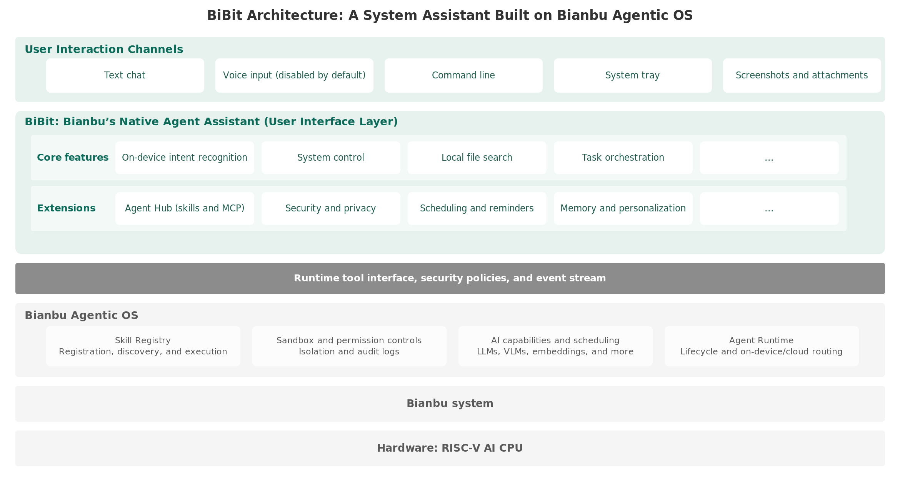

# Bianbu Agentic

**Bianbu Agentic** is the system foundation for AI agents on SpacemiT K-series devices, designed to help agents run effectively, reliably, and securely.

## BiBit Desktop Assistant

BiBit is Bianbu Agentic's desktop assistant and user interaction interface. It brings together desktop chat, expert selection, device operations, local file search, and extensible capabilities.

The diagram marks voice input as disabled by default. The current desktop version of Quick Chat supports keyboard input.

For setup and operating instructions, see the [BiBit User Guide](bibit/index.md).
