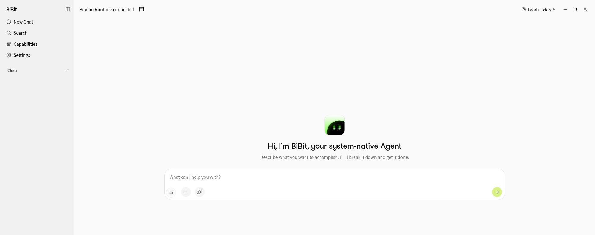
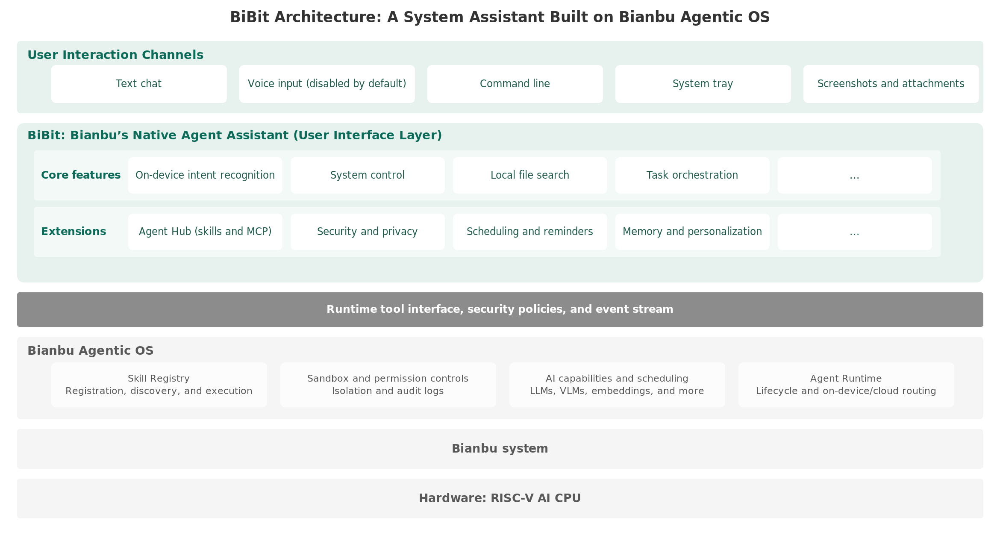

# Bianbu Agentic

**Bianbu Agentic** is the system foundation for AI agents on SpacemiT K-series devices, designed to help agents run effectively, reliably, and securely.

## BiBit Desktop Assistant

BiBit is Bianbu Agentic's desktop assistant and user interaction interface. It brings together desktop chat, expert selection, device operations, local file search, and extensible capabilities.

> A native system agent for Bianbu Desktop — an on-device-first AI assistant that lets users control their devices with natural language and carry out tasks.

---

### What Is BiBit?

**BiBit is Bianbu's native AI system assistant, built on Bianbu Agentic OS.**

Unlike an add-on voice assistant or search box, BiBit is a system-level agent interface **built into Bianbu, distributed with it, and ready to use out of the box**. BiBit focuses on user interaction, while Bianbu Agentic OS provides the Runtime, security, and Skill infrastructure. This allows BiBit to ship as a lightweight, ready-to-use assistant.

BiBit runs on Bianbu and Agent OS. Its core capabilities are:

- **System-native Agent:** Users entrust device management and operation requests to BiBit, which recognizes intent, orchestrates tasks, and executes them;
- **Community knowledge entry point:** Connects to the SpacemiT community knowledge base; community documents, tutorials, and FAQs inform BiBit's answers, with sources and citations shown;
- **Unified human–Agent entry point:** Interact with the system through desktop chat or the CLI;
- **Extensible capabilities:** Uses custom Skills, MCP, experts, and other capabilities to keep expanding custom capabilities.

#### Why the Name BiBit?

**Bi** comes from **Bianbu**, and **Bit** is the smallest unit of information — suggesting that BiBit helps users complete tasks bit by bit. Its two B's (Bi + Bit) also echo the Bianbu brand and the close connection between BiBit and Bianbu.

---

### Product Positioning

| Aspect | BiBit |
| --- | --- |
| Core role | **Bianbu's native system assistant**, Bianbu's Agent interaction entry point |
| Audience | **Developers + system users** |
| Core capabilities | **Task orchestration + system management + local file search** |
| Technical approach | **On-device capabilities first + on-device/cloud coordination** |
| Developer value | **Core value (system management + custom development)** |

**In one sentence:** Bianbu Agentic OS is the Agent system foundation for developers. BiBit is the native Agent on that foundation and provides users with an interaction entry point — an “AI system steward” for everyday users and an “AI pair partner” for developers.

---

### Product Architecture

BiBit is built on a unified technical foundation: the client handles desktop integration such as windows, the tray, and shortcuts; Agent tool calls follow Runtime and security policies and respect device permissions.

The diagram shows the overall architecture. The current desktop version supports keyboard input only in Quick Chat.

---

### Core Features

| Feature | Description |
| --- | --- |
| On-device intent recognition | Rules and on-device capabilities recognize clear device operations first, with low latency and an on-device loop; complex tasks are broken down automatically. |
| System operations | Use natural language to operate files, windows, networks, volume, themes, and more; software installation, environment setup, and system configuration proceed with step-by-step confirmation and results. |
| Local file search | An on-device model supports local file search using filenames, metadata, and content embeddings. Semantic search locates files in seconds; results can be opened, located in their folders, or selected for a summary. |
| Task orchestration | Organize multistep tasks through Skill call chains, with visible steps, progress, and failures; cross-app operations use available tools. |
| File parsing | Locally parse PDFs, Word documents, images, and other files; support format conversions such as PDF → Markdown; parsed results are directly searchable and citable. |
| Screenshot understanding | Take a quick screenshot to ask BiBit, using the image as input; preview, remove, or replace the screenshot before confirming upload. |
| Agent Hub | Access the community Skill marketplace for one-click installation; support knowledge-base expansion and custom Skill creation as capabilities continue to grow. |
| Developer support | Connect to the SpacemiT community knowledge base for one-click citation and answers; preinstalled development and testing Skills support low-level and AI development; connect to VibeCoding tools to help users develop with AI. |
| Schedule and reminders | Work with the system calendar to create events through conversation, remind users when due, and manage Do Not Disturb periods. |
| Memory and personalization | When memory is enabled, BiBit can save what users like to be called, their usual preferences, and development habits, and refer to recent conversation summaries to tailor later answers. Users can set retention periods, clear memory, and import or export memory data. |
| Security and privacy | Permission controls (tasks classified by risk, with confirmation for sensitive actions), sandbox isolation (process/file/network isolation), and privacy detection (sensitive data stays on-device). |

---

### Value for Bianbu Users

- **Operate the system with natural language** — “Dim the screen,” “open a terminal,” or “switch to a dark theme” in one request and receive a result; installation, configuration, and Agent and Skill management proceed with step-by-step confirmation and execution;
- **Search local files semantically** — Use filenames, metadata, and content embeddings to find “last month's documents about Agent scheduling”; open results, locate their folders, or summarize them;
- **Make development and troubleshooting easier** — Ask “How do I create an Agent or register a Skill?” and get answers with sources from the SpacemiT Knowledge Assistant; paste an error log for analysis or run `bibit --doctor` to diagnose the environment;
- **Automate workflows** — Skill orchestration: check the environment → confirm installation → verify the result; see the steps, progress, and failures of multistep tasks;
- **Get help that knows you better over time** — When memory is enabled, BiBit can refer to saved names, preferences, and recent conversation summaries, reducing repeated explanations and making later conversations more coherent.

---

### Quick Start

| Entry point | Action | Use case |
| --- | --- | --- |
| Tray icon | Click the BiBit icon in the taskbar to open Quick Chat | Mouse use |
| CLI | `bibit` or `bibit "your question"`; `bibit --doctor` | Developer terminal |

---

*BiBit ships with Bianbu. Community contributions are welcome.*

For complete setup and operating instructions, see the [BiBit User Guide](user_guide/index.md), or start with [Quick Start](user_guide/quickstart.md).
