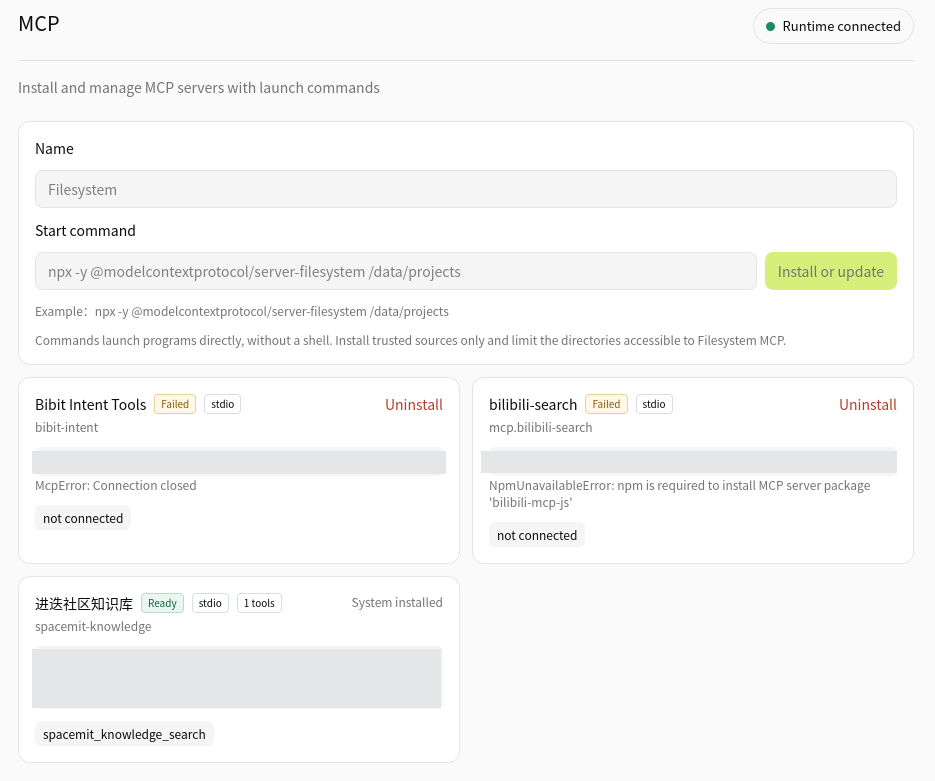

# MCP

Use **Settings → Management → MCP** to install and manage standalone MCP servers, which provide additional tools for agents. Installing or updating a server changes what Runtime Workers start.

Requirements: Runtime is connected and the device can run the required commands and dependencies.



## Install or Update an MCP Server

1. Enter a recognizable **Name**, such as `Filesystem`.
2. Enter the complete **Start command**, for example:

   ```text
   npx -y @modelcontextprotocol/server-filesystem /data/projects
   ```

3. Click **Install or Update** and wait for the page to refresh the status. The first installation may download dependencies, so **Preparing** can last one or two minutes.
4. Once **Ready**, check the card's tool count or names.

**Expected result:** The server appears in the list as **Ready** with available tool counts or names. Open [Experts](experts.md) and, under **MCP**, select the server for experts that need those tools.

## Understand Status

| Status | Meaning and action |
| --- | --- |
| **Not Loaded** | Runtime has not started it; click **Refresh** at the top to retry |
| **Preparing** | Starting and handshaking; downloading dependencies on first use may take longer |
| **Ready** | Connected and able to provide tools |
| **Degraded** | Partly available; check the card's explanation and tool list |
| **Failed** | Startup failed; read the error, fix the command or dependencies, and retry |
| **Stopped** | Not currently running |
| **Unknown** | Loading status is temporarily unavailable; click **Refresh** |

**Refresh** at the top reloads the catalog and performs health checks. The MCP and Plugins pages do not require a second refresh button.

## Uninstall an MCP Server

On the server card, click **Uninstall**, review the confirmation, and proceed. Servers marked **System Installed** cannot be uninstalled from this page. Uninstalling a server also removes its tools, so you may need to update the configuration of any experts that depend on them.

## MCP Servers Bundled with Plugins

Bundled MCP servers belong to their plugins and show their status on the [Plugins](plugins.md) page. MCP management lists standalone installations only. A notice that bundled servers appear under Plugins is normal.

## Notes

- Launch commands start programs directly without a shell. Use trusted sources and limit the directories accessible to Filesystem MCP.
- Do not put passwords, tokens, or other secrets directly in launch commands. Use the service's secure configuration mechanism.
- If the page does not update after an installation, update, or uninstall finishes, refresh to check actual state. Do not immediately repeat the installation.
- A server marked **Ready** is connected, but not every tool it provides will necessarily be suitable for the current expert. You still need to select the server in the expert's configuration.

[Runtime Management and Monitoring](index.md) · [Plugins](plugins.md) · [Experts](experts.md) · [Quick Start](../quickstart.md) · [FAQ](../faq.md) · [Documentation Home](../index.md)
