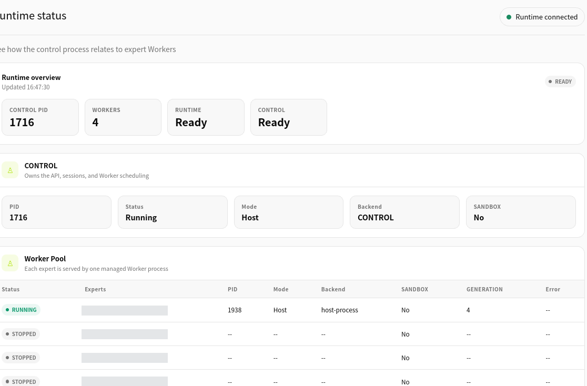

# Runtime Monitoring

The three **Settings → Monitoring** pages show Runtime activity: **Agent Top**, **Runtime Status**, and **Logs**. They are primarily read-only and do not change experts or security policies.

Requirements: Runtime is connected. Pages refresh every 3 seconds. Click **Refresh** at the upper right for an immediate update.

## Agent Top

Agent Top shows experts, conversations, and executions in real time.

| Area | Contents |
| --- | --- |
| **Runtime overview** | Expert count, available experts, conversations, runs, active runs, waiting runs, and failures |
| **Experts** | Each expert's status, conversations, runs, active runs, failures, and recent activity |
| **Recent Runs** | Status, run ID, expert, conversation, and update time for recent executions |

Click **Refresh** at the top of the page to update immediately. Status and counts reflect the Runtime snapshot at the time of reading. If they remain unchanged briefly, check whether the task is still running or awaiting approval.

The **LAST** column may show `--` or a relative time such as `0s`. A relative time indicates how long it has been since the most recent activity, measured when the data was read—not when the task started.

## Runtime Status

This page shows the relationship between the Control process and agent Workers.

| Area | Contents |
| --- | --- |
| **Runtime overview** | Control PID, Worker count, Runtime status, and Control readiness |
| **Control process** | PID, status, mode, backend, and sandbox setting |
| **Worker Pool** | Each agent's Worker status, PID, mode, backend, sandbox, generation, and error |

**Control** is the control plane process responsible for APIs, conversations, and Worker scheduling. **Worker** is the process that actually executes agent tasks. **No workers** appears when none exist, usually because no task has started or Workers have not launched yet.

If a Worker shows an error, record the full error and check **Logs** first. Do not repeatedly restart services without confirming the cause.

## Logs

The read-only log page displays `runtime.jsonl` with colors by severity.

1. Use **DEBUG**, **INFO**, **WARNING**, **ERROR**, and **CRITICAL** checkboxes to show or hide levels.
2. New logs automatically scroll the page to the end.
3. **No log records** appears when there are no entries.

Logs help investigate Runtime connections, Worker startup, tool execution, and service errors. Share only relevant excerpts with the developer community, after removing personal information, file paths, API Keys, and other sensitive content.

## Missing Pages or Empty Data

- If **Monitoring** is absent from the sidebar, check under **Settings → Extensions** that the Runtime management extension is installed and enabled.
- If **Runtime unavailable** persists, check that the Runtime service is running and refresh after connectivity recovers.
- If the page exists but has no data, check whether experts, conversations, or executions have been created. A newly started Runtime may not have records yet.
- Empty logs do not prove the service is healthy. Check Runtime status and actual conversation results as well.

[Runtime Management and Monitoring](index.md) · [Security](security.md) · [Quick Start](../quickstart.md) · [FAQ](../faq.md) · [Documentation Home](../index.md)
