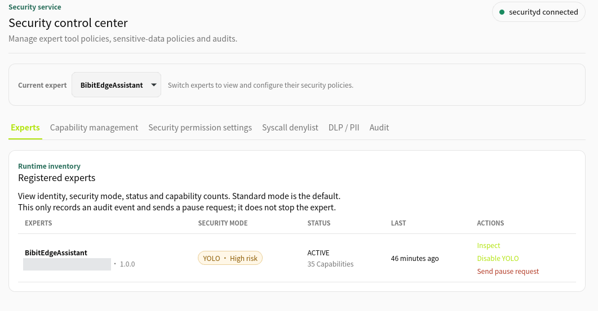

# Security

**Settings → Management → Security** is Runtime's security control center for agent security modes, tool authorization, file and network boundaries, system calls, DLP policies, and auditing. These settings affect what agents can do. Understand their impact before making changes.

Requirements: The top of the page shows **securityd connected**. If it shows **securityd unavailable** or **Host capability unavailable**, check the services as described in [Runtime Management and Monitoring](index.md) before changing policies.

## Select the Current Agent

Use **Current Agent** at the top. Capability management, security permissions, system calls, DLP, and auditing below apply only to that agent. Switching agents reloads the selected agent's policies.

The page has six tabs:

| Tab | Purpose |
| --- | --- |
| **Agent** | View registered agents, modes, and status, and switch between Standard and YOLO |
| **Capability Management** | Set `allow`, `ask`, or `deny` for tools |
| **Security permission settings** | Set read-only/read-write paths and network access policies |
| **Syscall denylist** | Select system calls to block |
| **DLP / PII** | Choose whether sensitive information is redacted or allowed |
| **Audit** | View security events and verify the hash chain |

## Agents and Security Modes

The **Agent** tab lists registered agents with their security modes, status, recent activity, and capability counts.

- **Standard Mode**: Tools follow `allow` / `ask` / `deny`. DLP, file and network boundaries, and system call filtering apply.
- **YOLO · High Risk**: Tools are allowed by default. DLP, file and network restrictions, and approvals are bypassed, while auditing remains. Agents run with permissions closer to the host's.
- **Send Pause Request**: Records an audit event and sends a pause request; it does not stop agent execution. Use the stop action in the conversation to stop a task.

Changing modes opens a confirmation dialog. Read the prompt before clicking **Switch**. Switching back to Standard restores saved restrictions.

**Use YOLO only when you fully trust the current task and agent.** Keep Standard mode if you are unsure.

## Capability Management

**Capability Management** determines whether a tool can be called:

| Policy | Behavior |
| --- | --- |
| `allow` | Allow directly |
| `ask` | Request confirmation first |
| `deny` | Reject the call |

1. Find the tool and use the **Policy** dropdown to select `allow`, `ask`, or `deny`. Changes are submitted immediately.
2. Click **Add Tool Policy** to enter a tool name and policy. Choose a suggested name or enter one not yet in the catalog.
3. Undeclared tools follow the unmapped default policy.

Policy counts appear at the top, such as `3 allow · 1 ask · 0 deny`. Changes apply only to the current agent.

## Security Permissions

**Capability Management** decides whether a tool can be called. The **Security permission settings** tab controls what it can access afterward.

| Setting | Description |
| --- | --- |
| **Read-only Paths** | One path per line, mounted with `--ro-bind`; readable but not writable |
| **Read-write Paths** | One path per line, mounted with `--bind`; reading and writing allowed |
| **Network Access Mode** | **Allow All**, **Allowlist**, or **Deny All**; some environments also offer **Learning** |
| **Allowlisted Domains** | One domain per line for Allowlist mode; wildcards such as `*.example.com` are supported |

Paths must start with `/` and must not contain `..`. Read-write access already includes read access, so there is no need to add the same path to both lists. Before saving, the page shows counts of changes to read-only paths, read-write paths, and network policies. Review **Preview Before Saving**, then click **Save and Apply**.

**Effective Sandbox Scope** shows the boundaries actually passed to Workers at startup, including declared paths, system integration mounts, and the default baseline. Fixed system-blocked paths cannot be changed here.

**New or restarted Workers apply saved file and network permissions; existing Workers do not change immediately.** If saving partially fails, follow the prompt to retry the remaining changes.

## System Call Blocklist

The System Call page loads its catalog by architecture, following the local kernel by default. Under **Architecture**, you can also select `riscv64` or `x86_64`.

1. Select calls to block, such as `ptrace`. Calls are unrestricted by default; selecting one blocks it. There is no mandatory baseline.
2. Click **Save Policy** and check for a restart-pending or applied status.
3. Start a new request. Runtime restarts the Worker automatically.
4. Refresh this page, confirm **Applied**, and check **Syscall interception audit** for records.

System call policies load only in Standard mode with the sandbox. YOLO Workers use host mode without seccomp. Saved policies take effect again after returning to Standard. **Restore Defaults** clears this agent's blocked calls for the current architecture.

## DLP / PII

DLP controls sensitive-information handling. Each PII type has two actions:

- **Mask**: Replace or mask matched content.
- **Allow**: Leave that type unchanged.

Change individual types, or use **Mask all** or **Allow all**. Batch actions update only types whose action differs. If some saves fail, the prompt shows the unsaved count. **Restore Defaults** removes the type's custom policy.

At the bottom of the page, under **DLP text scan**, enter text and click **Scan text** to view match counts and redacted output. A test scan does not send a chat message.

**YOLO does not run DLP scanning or checks**, but keeps Standard mode rules and audit records.

## Audit

The Audit tab records security hooks, permission decisions, and policy changes. Filter by **All Events**, **Security Hooks**, or **Denied Only**.

- The table shows sequence number, time, action, target, and result.
- Use **Previous Page** / **Next Page**. Pagination reads from the same snapshot.
- Click **Verify Hash Chain** to check integrity. Results show **Hash Chain Intact** or **Verification Failed**.
- If BiBit reports **Audit pagination is unavailable. Please update Runtime and Security services.**, check whether the two services support the current pagination interface. If the problem persists after updating, report the full message to the developer community.

Audit records may contain tool names, paths, and operation targets. Check for personal information, keys, and sensitive paths before sharing logs or screenshots.

## Before Changing Security Policies

1. Check the selected agent.
2. Read the prompts and understand Standard versus YOLO mode.
3. Review path, network, and policy changes in **Preview Before Saving**.
4. Change one category at a time, save it, and verify the result before continuing.
5. If the result is unclear, refresh the page or check the audit log. Do not submit the same change repeatedly.

[Runtime Management and Monitoring](index.md) · [Experts](experts.md) · [Quick Start](../quickstart.md) · [FAQ](../faq.md) · [Documentation Home](../index.md)
