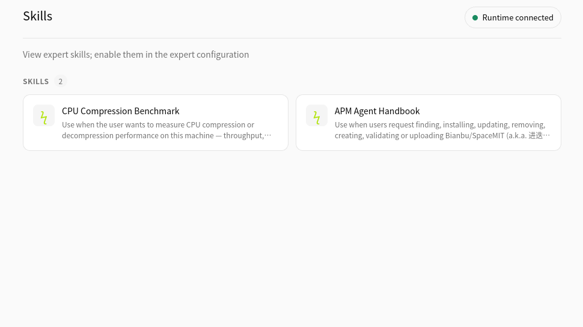

# Skills

Use **Settings → Management → Skills** to view the skills Runtime makes available to agents. This read-only page shows skill names, descriptions, and counts. Expert configuration determines which skills are enabled.

Requirements: Runtime is connected.

## View Skills

Skill cards show names and purposes. Some have language-specific descriptions. If no description is available, use the name and the expert's actual selection as a reference.

Skills can be built into Runtime or come from plugins or installed capability packages. An expert uses only the selected skills and Runtime's fixed default capabilities.

## Enable Skills for an Expert

1. Open [Experts](experts.md) and select the expert.
2. Select skills under **Skills**. Items marked **Default capability, always on for every expert** cannot be deselected.
3. Click **Save** and wait for confirmation.
4. Describe your task in later chats. The expert selects skills according to its configuration; you normally do not need to name them.

**Expected result:** Once the configuration is saved, the expert can use the selected skills. Skill references or execution results in the conversation show what was actually used.

## Missing or Unselectable Skills

- Check for **Runtime connected** at the top. A failed connection may leave the catalog empty.
- Check that the skill is appropriate for the current expert; availability can differ between experts.
- Skills are provided by Runtime, plugins, or capability packages. This page does not install, update, or delete them. To install or update a skill, use Agent Hub, plugin management, or the relevant capability package's management interface.
- A default capability cannot be deselected. This is a Runtime configuration rule, not a page error.

## Difference from Temporary Skills

**Use a skill** in the chat input area applies only to the next message. The skills catalog and expert configuration determine which skills are available to an expert on an ongoing basis. To use a skill for a single request, select it in the input area; to change an expert's ongoing capabilities, edit the expert's configuration.

[Runtime Management and Monitoring](index.md) · [Experts](experts.md) · [Tools](tools.md) · [Quick Start](../quickstart.md) · [FAQ](../faq.md) · [Documentation Home](../index.md)
