# Agent Hub

Agent Hub appears as **能力中心** in the Chinese BiBit sidebar. It lets you view, install, and manage capabilities for the selected agent.

Prerequisite: **Agent Hub** appears in the sidebar. This entry is provided by the Agent Hub plugin. If the entry is missing, check under **Settings → Extensions** that the plugin is installed and enabled. Restart BiBit if prompted. If the service is unavailable, read the full error and contact the developer community if you cannot resolve the issue.

Open **Agent Hub** to access three tabs:

| Tab | Purpose |
| --- | --- |
| My Capabilities | View installed capabilities and automatically detected local custom resources for the installation target selected in **Agent** |
| Capability Market | Find capabilities, view available versions, and install or switch versions for the selected agent |
| Settings | Manage the API key needed to upload custom resources to APC, the developer platform's capability publishing service |

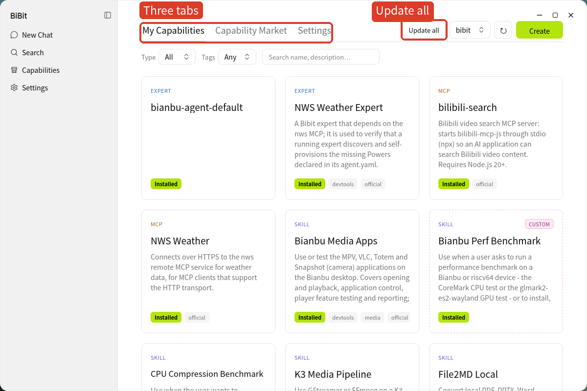

## Find and Install Capabilities

1. Open **Capability Market** and select the target agent from the **Agent** control. Select **bibit** for use with BiBit. This selection does not change the expert selected in chat.

   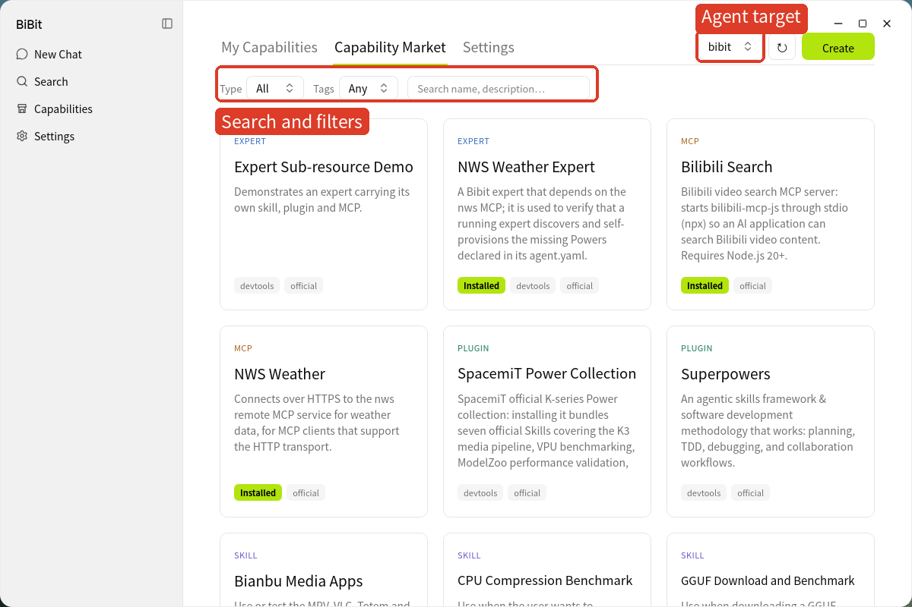

   Expand the Agent control to switch targets. In addition to **bibit**, targets include Codex, Claude-Code, and Hermes-Agent:

   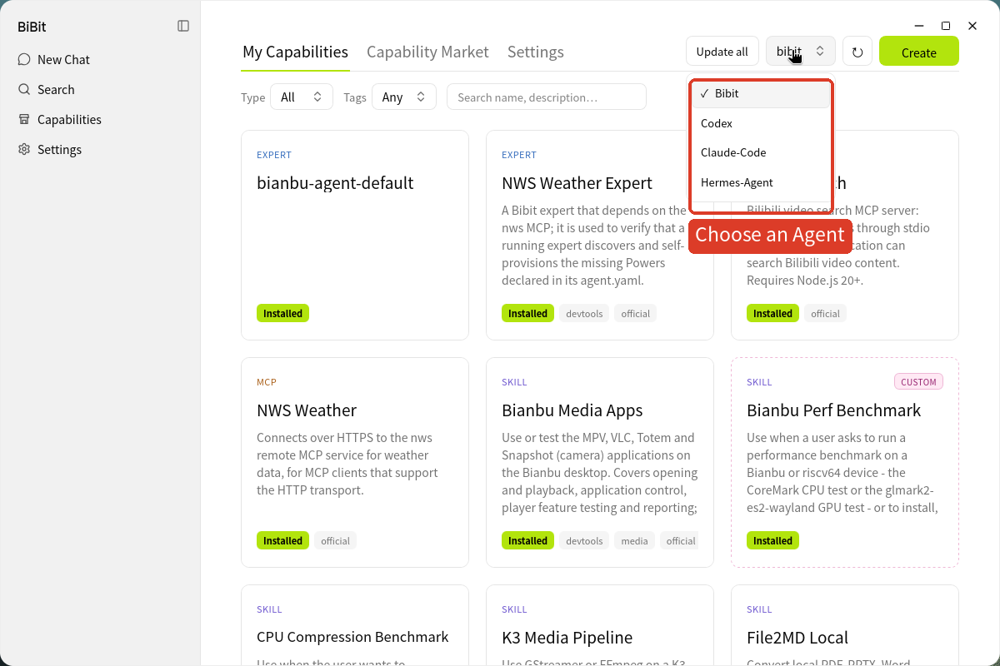

2. Search using the **Search name, description…** field. Use **Type** and **Tags** to filter as needed.

   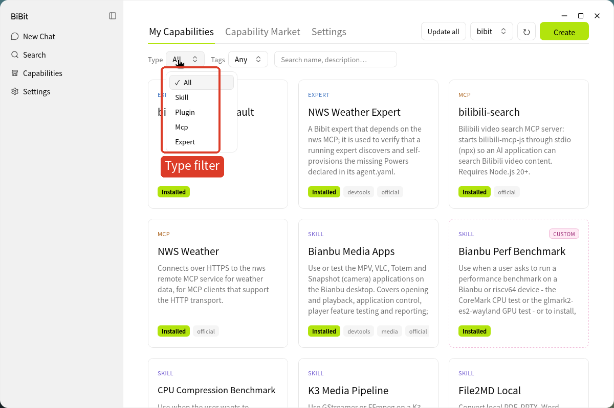

3. Click a card to read its description, versions, and installation status. For an uninstalled market capability, you can also click **Add Capability** on the card to install the version offered there.

   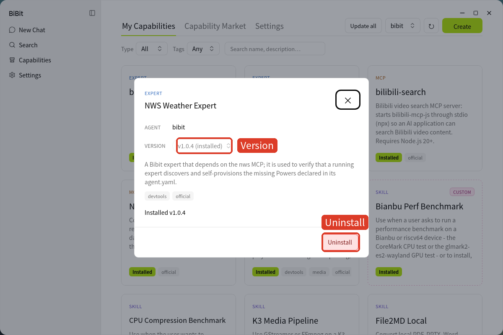

4. To install a capability for the first time, select a version in its details and click **Install**. To replace an installed version, click **Update** or **Downgrade**, review the prompt, and select **Confirm update** or **Confirm downgrade**.

   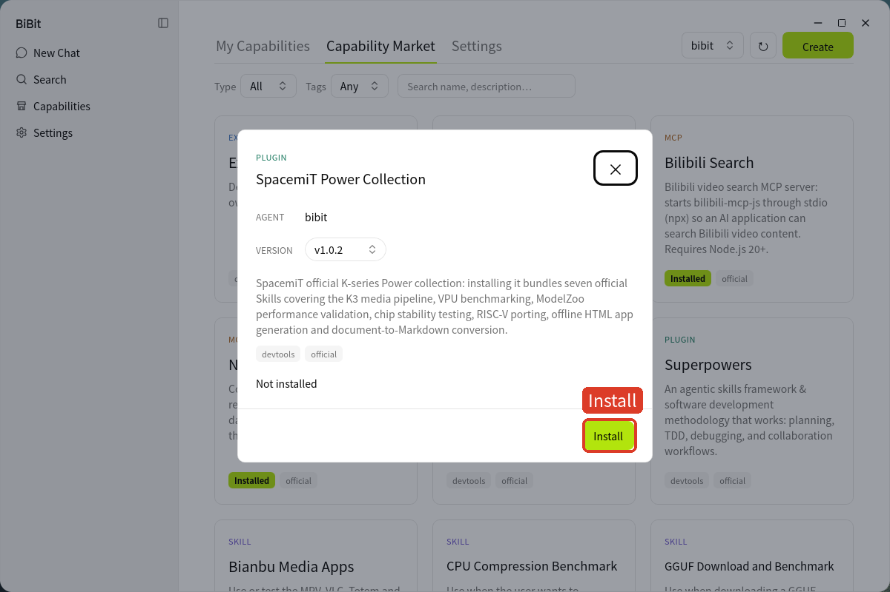

5. Wait for the operation and installation-state checks. After **Installation Complete**, open **My Capabilities** to check the result for the selected target. Use **Refresh** to reload it.

   **Expected result:** The capability is installed for the selected agent, and its actual installed version is displayed. Skills, plugins, MCP servers, and experts serve different purposes. Their usage entry points depend on the resource type and service support. To select an expert in chat, follow [Select an Expert](chat.md#select-an-expert).

## Update and Remove Capabilities

- To change one capability's version, open its details in **Capability Market**, select a version, click **Update** or **Downgrade**, then confirm the change.
- For a batch update, open **My Capabilities**, click **Update All**, confirm the agents to update in the dialog, and proceed.

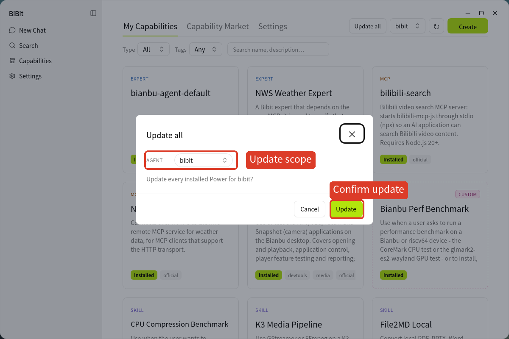

- To uninstall an installed market capability, open its details, select the installed version, click **Uninstall → Confirm Uninstall**, and verify the target and resource name.

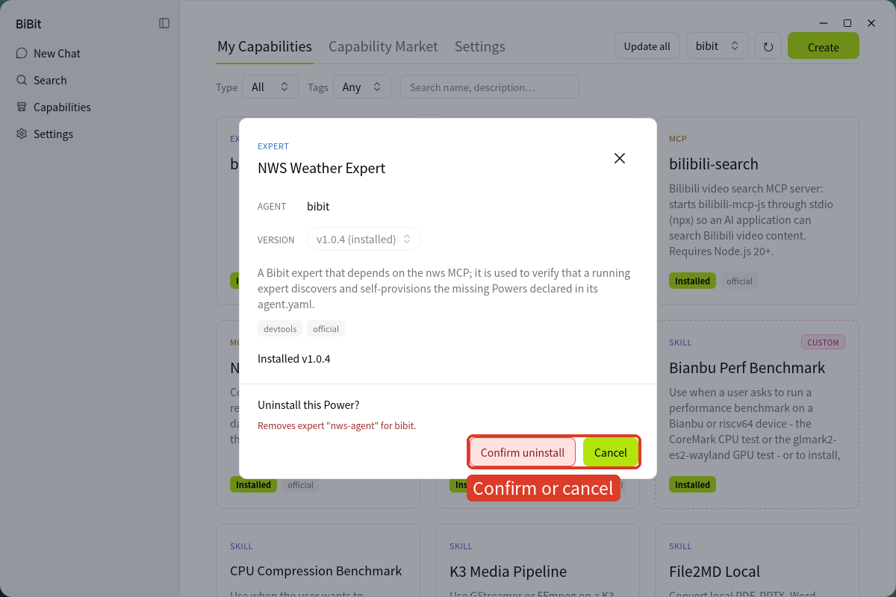

- For resources marked **Custom**, click **Delete**, then **Confirm Delete**. This permanently deletes the local resource for the selected agent. Back it up first if needed.

If an operation's result or installation status cannot be confirmed, refresh to read the actual state before repeating an install, uninstall, or update. If an action is unauthorized or unsupported, record the full message and ask the developer community.

## Get an APC API Key

Uploading custom resources requires an APC API Key from the SpacemiT developer platform:

1. Open the [SpacemiT developer platform](https://developer.spacemit.com) and go to **Developer API Key** in your account settings. If you are not signed in, follow the prompts on the sign-in page to sign in with your developer account.

   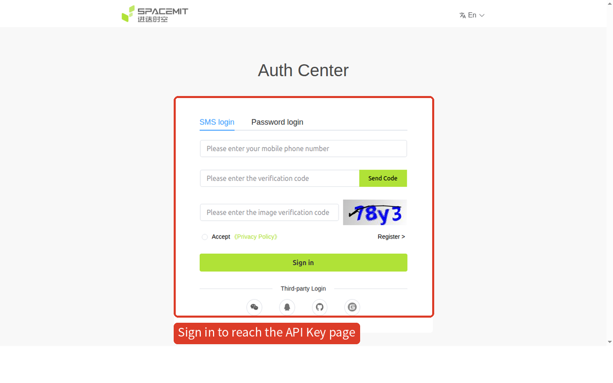

2. After signing in, open the **Developer API Key** page to create or view a key, then copy its complete value. Keys are sensitive credentials. Do not paste them into chats, screenshots, or public documents.

3. Return to BiBit, paste and save the key under **Agent Hub → Settings**, as described in the next section.

## Create a Capability Draft

Click **Create** to open a new chat with a draft prompt for creating a capability in the input box. Specify the resource type and requirements, review the draft, and send it. Clicking **Create** does not send the message or mean the resource has been generated. If the feature is unavailable, follow the prompt. If asked to clear the input box, save any existing draft before clearing it and retrying.

## Upload an Existing Custom Resource

**Prerequisites:** You need a valid API key and a resource marked **Custom** under **My Capabilities**. The resource must meet **Power format v2**. If it does not, follow the on-screen prompt before retrying. Before uploading the resource to the developer platform, check that its contents are suitable for public sharing.

1. Open **Agent Hub → Settings**, enter a valid APC API Key in the **APC API Key** field, and click **Save Key**. Wait for the success message, then check that the required key is marked **Enabled**; click **Enable** if it is not. Saved keys are masked, and **Delete** removes a key.

   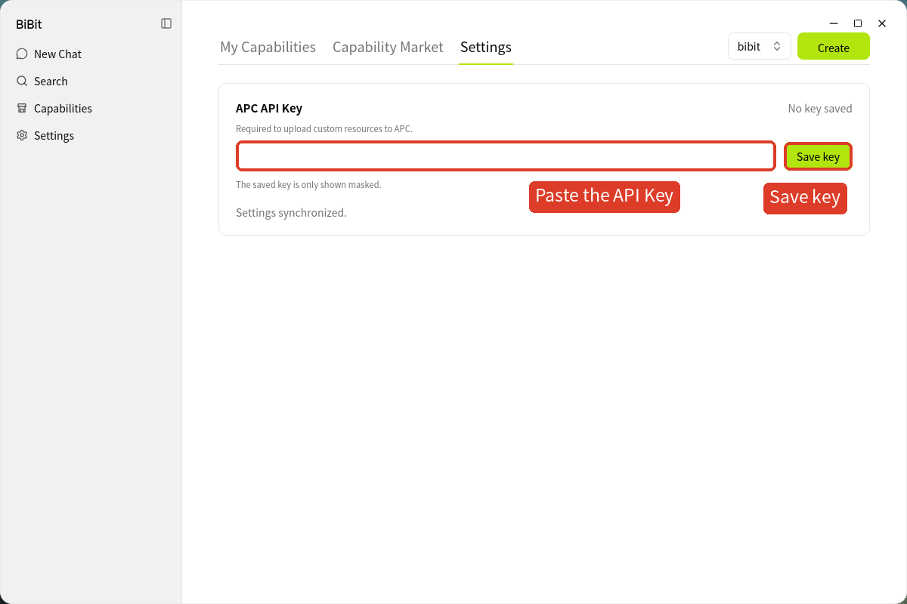

2. Return to **My Capabilities**, check the **Agent** target, open the custom resource's details, and click **Upload**.

   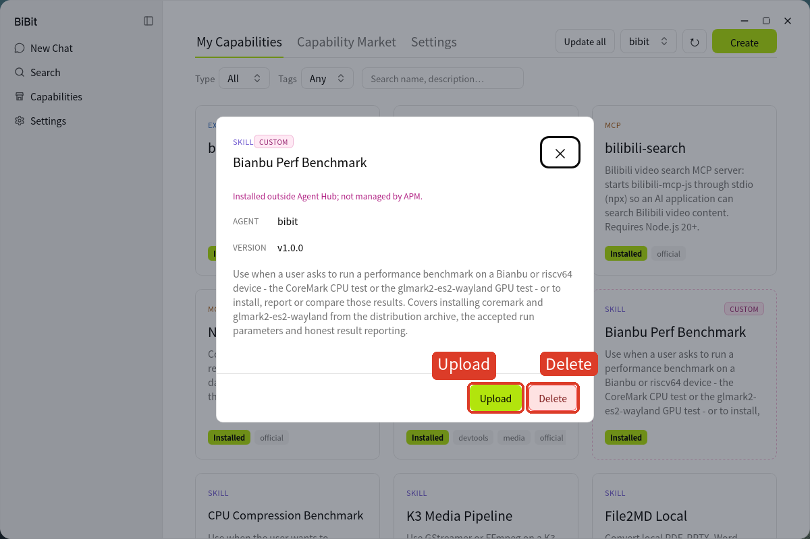

3. Enter the required **Publish message**, up to 200 characters, click **Upload to APC**, and wait for completion.

    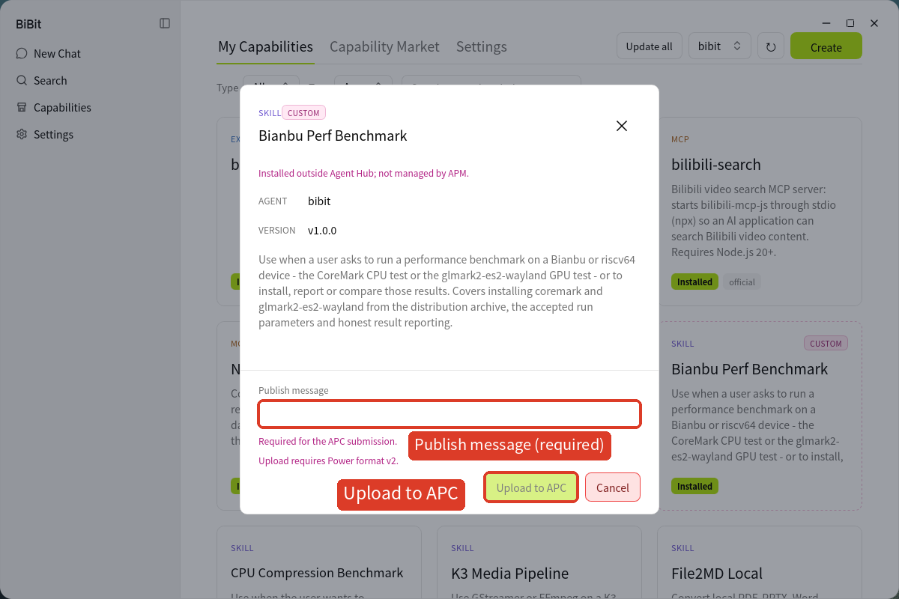

Here, **Settings** is a tab inside Agent Hub. Upload starts from an existing custom resource's details. If the key is missing or the format is unsuitable, follow the prompt to correct it before trying again.

[Quick Start](../quickstart.md) · [FAQ](../faq.md) · [Documentation Home](../../index.md)
