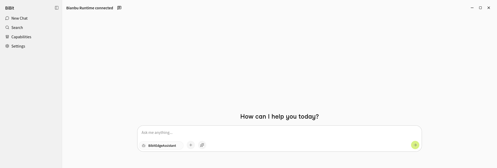
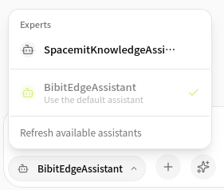

# Chat and Conversation Management

This page covers the main window, experts, temporary skills, and conversation history. To send your first question, see [Quick Start](../quickstart.md).

## Main Window and Desktop Entry Points

Figure: The main window and sidebar entry points.

| Area or entry point | Purpose |
| --- | --- |
| New Chat in the sidebar | Start a new topic |
| Search in the sidebar | Find conversations by title or message text when supported; see [Search Chats](#search-chats) for details |
| Settings | Adjust language, appearance, desktop integration, shortcuts, and extensions |
| Conversation list in the sidebar | Return to earlier chats and check whether tasks are running or awaiting approval |
| Conversation area | Read questions, answers, tool results, and operations awaiting confirmation |
| Input area | Enter text, select an expert, or add attachments or temporary skills; available buttons depend on the current conversation's capabilities |
| System tray icon | Open quick chat; its right-click menu opens the main window, shows or hides the floating icon, or quits BiBit |
| Desktop floating icon | Click once to open Quick Chat, double-click to open the main window, or drag to reposition it |

Press **Ctrl+B** to show the sidebar when hidden; press it again to hide it. Plugins may add entries such as **Agent Hub** and **Memory** to the sidebar or settings. If these entries are unavailable on your device, you can still use other available features. See [Agent Hub](agent-hub.md) and [Memory](memory.md).

## Conversations, Experts, and Skills

### Ask Questions That Get Useful Answers

Explain what to work on, the result you need, and any constraints. For example:

> Rewrite the following notice for my colleagues. Keep the meeting time and location, and use no more than 150 characters.

> List three key points from the file I uploaded and explain which part of the file supports each point.

To change an answer, add instructions such as “Make it shorter,” “Use a table,” or “Keep the first item and rewrite the other two.” Check important facts against the original file or references.

### Select an Expert

Experts are assistants for particular tasks, such as office work, file processing, or other specialties available on your device.

1. Click **New Chat**.
2. Click the assistant name below the input box to open the **Experts** list.
3. Select an expert, enter your question, and send it.
4. To return to the default assistant, select **Use the default assistant**.

**Expected result:** The new conversation uses the selected expert. You can view the expert information shown in the conversation.

**Note:** Expert selection applies only to new conversations and does not affect existing ones. Existing conversations keep the expert assigned when they were created. To use another expert, start a new chat and select it there.

If the expert list is empty, click the refresh control in the list. If the expert is unavailable because no global model is selected, add and select a model under **Settings → Management → Models**. If an expert is unavailable for another reason, record the full message and contact the developer community if you cannot resolve the issue.

Figure: Click the expert name in the input area to view available experts.

### Temporarily Select Skills for the Next Message

Requirements: The current assistant service supports skill selection, and the input area shows the sparkle-shaped **Use a skill** button.

1. Click the button.
2. Search by skill name or description.
3. Click the skills you need and check that their tags appear in the input area.
4. Enter your task and send it. If you do not need a skill before sending, click the remove button on its tag.

**Expected result:** The selected skills are submitted with the next message; they are not permanently enabled. Check the selection in the input area before using skills again. The service may also use other skills available to the expert. Skill references in the response can help you see which skills were actually used.

### Continue Typing or Stop During an Answer

- You can prepare your next question in the input box while an answer is being generated. It is recommended that you wait for the current answer to finish before sending it. Current Runtime conversations do not provide a message queue that can be edited, canceled, or cleared.
- To interrupt an answer, click the stop button at the lower right of the input box, labeled **Stop generating**.

Attachments, screenshots, or knowledge base tasks may require the previous turn to finish. Follow any explicit waiting prompt and avoid clicking Send repeatedly.

### Copy Messages

Current Runtime conversations support copying messages only. Hover over a message and click the copy button to copy its text to the clipboard.

| Action | Purpose and result |
| --- | --- |
| Copy | Copy text to the clipboard so you can paste it into another application |

Runtime currently does not support editing, regenerating, continuing generation, deleting individual messages, or switching message versions. These actions are therefore absent from Runtime conversations.

## Find and Organize Conversation History

### Search Chats

1. Click **Search** in the sidebar, or press **Ctrl+K**.
2. Enter text from a conversation title, or keywords from a message you sent or an assistant's response.
3. Select a conversation or message from the search results.

**Expected result:**

- **Chats:** Conversations whose titles match the search terms are listed. Click one to open it.
- **Messages:** If the service supports message-text search, matching results show the conversation and a message excerpt. Click a result to jump to that message.

When the search box is empty, you can choose from recently visited conversations.

This searches chat history. To find files on your computer, see [Local File Search](files.md#find-open-and-summarize-local-files).

### Rename, Pin, and Delete Conversations

Hover over a conversation title in the sidebar, click **…**, and choose:

- **Rename**: Enter a recognizable title such as “Weekly Report” or “Expense Documents.”
- **Pin**: Move a frequently used conversation to the top. Select **Unpin** to undo this.
- **Delete**: Read the confirmation and delete the conversation. Do not use deletion to pause a task or clear ordinary cache data.

When several conversations are listed, the **…** menu beside the group heading provides **Delete All** only. A confirmation appears before deletion. Deletion cannot be undone.

### Understand Conversation Status

| Status or indicator | What to do next |
| --- | --- |
| Running or spinning icon | Wait, or open the conversation to check progress |
| Awaiting confirmation or approval | Open the conversation and review the operation requiring your decision |
| Completed but unread | Open the conversation to read the result |
| Failed | Read the error and use the provided retry action |

[Quick Start](../quickstart.md) · [FAQ](../faq.md) · [Documentation Home](../../index.md)
