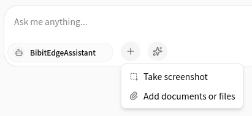
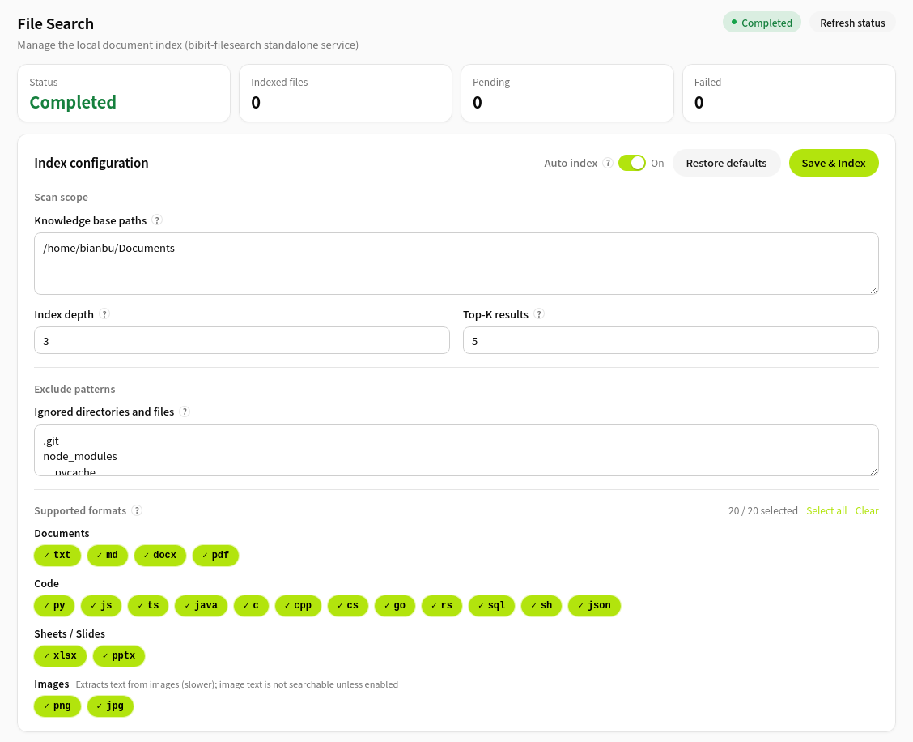

# Files and Reference Materials

This page covers attachments, screenshot questions, local file search, and knowledge base references. These capabilities must be available on your device and through the current assistant.

## Add Documents, Files, and Screenshots

### Attach a File and Ask a Question

Requirements: The current conversation supports attachments and the input area shows a **＋** button.

1. Make sure you’ve selected the correct conversation and expert.
2. Click **＋ → Add documents or files** in the input area.
3. Select a file in the file picker.
4. Check that the file appears in the input area. In a new conversation, it stays as a draft until you send the first message. In an existing conversation, wait if BiBit shows that the attachment is still processing.
5. Enter instructions such as “Summarize this file and list three action items,” then send.

**Expected result:** The message includes file information, and the assistant processes the file and responds according to the capabilities supported by the service and model. Sending only an attachment may use a default file-processing prompt. Include specific instructions for a clearer result.

Supported formats and size limits are shown by the picker and subsequent prompts. Being able to select a file does not guarantee that the current model understands it. Before submitting images, scans, audio, or video, check that the device provides the necessary capabilities.

Figure: The **+** menu offers **Take screenshot** and **Add documents or files**.

### Failed Uploads or the Wrong File

- **Upload failed**: Use the failed attachment's retry action. Follow the prompt to select the file again, or remove it and reselect it.
- **Processing**: Wait before sending. A spinning file tag does not mean the upload has succeeded.
- **Wrong file**: Remove the attachment before sending. In an existing conversation, removing its tag does not reverse an upload that has already occurred. Check sensitive files before selecting them.
- **Switching conversations**: Check which conversation owns the attachments before sending, so the files go to the intended expert and task.

### Ask BiBit About a Screenshot

Requirements: The Bianbu desktop session provides a working region screenshot tool, and BiBit's screenshot entry point is enabled.

1. Open the conversation that should receive the screenshots.
2. Click **＋ → Take screenshot**, or use the configured shortcut, **Super+Shift+S** by default.
3. Follow the on-screen instructions to select a region.
4. Return to BiBit and check the preview. Click **Take another** to add more, or remove or replace unwanted screenshots. A batch can contain up to **5 screenshots**.
5. On first use, read the screenshot privacy notice. Check the preview for passwords, chat content, or other information you do not intend to submit.
6. Enter a question such as “Explain the error in this screenshot,” click Send, and select **Upload anyway** when asked **Upload these screenshots?**

**Expected result:** Confirmed screenshots are uploaded as ordinary attachments to the current conversation and then processed by the assistant.

**Note:** A screenshot preview has not yet been sent. If the sending result is unconfirmed, use **Send again** to retry the original submission first. Do not repeatedly create new screenshots or change the expert receiving the original batch. Screenshots are uploaded; a local image does not guarantee fully offline processing.

## Find, Open, and Summarize Local Files

Requirements: The current expert has local file search capabilities and permission to search the target directory.

Open **Settings → Features → File Search**, choose the knowledge base path, and click **Save & Index**. The initial path is `~/Documents`; you can save it as is. Once indexing finishes, [find files with a sentence](#find-files-with-a-sentence). You can also adjust the path, indexing depth, and supported formats on this page.

Figure: **Settings → Features → File Search** shows indexing status, the knowledge base path, and supported formats.

### Find Files with a Sentence

In the chat, describe the filename, subject, or content you remember, for example:

> Find local files about travel expense reimbursement.

> Find documents containing “annual plan.”

**Expected result:** Successful searches show file result cards with filenames and available file information. If no results appear, try more specific keywords and check that the files are within the device's searchable directories.

### Use File Results

| What you want to do | Action |
| --- | --- |
| Open a file | Click its filename |
| Open its containing folder | Click **… → Open Containing Folder** |
| Summarize one file | Select its radio button, then click **Summarize selected file** |
| View more results | The overlay shows up to 3 items; use Open Main Window to see all results |

**Note:** Clicking a filename opens the file. Selecting its radio button chooses it for summarization. To summarize a file, the original conversation must be available. If a response is still being generated, wait for it to finish.

File cards show candidate results. A relative match score is not a probability of correctness and does not mean the entire file has been read. The candidate count is not the total number of relevant files on the device. If summaries or snippets are missing, open the original file. Search again if a file has moved, changed, or been deleted.

## Read Knowledge Base References

Requirements: The current assistant has access to a knowledge base, and the answer actually displays knowledge base references.

1. State the source scope and your question, for example: “Use the connected knowledge base to explain how to use this feature, and provide references.”
2. Wait for retrieval and the answer.
3. If the message shows **SpacemiT Knowledge Base · N references**, expand it to read excerpts. Use **View source**, when available, to check the original.

**Expected result:** You can see the reference material supplied to the model for that answer. Check the message's references and service result to confirm retrieval; merely mentioning a knowledge base does not guarantee that a search occurred.

If no references are found, change the keywords, narrow the question, or use general Q&A. A separate knowledge base switch may not exist, and this entry point is not available in every version or conversation.

[Quick Start](../quickstart.md) · [FAQ](../faq.md) · [Documentation Home](../../index.md)
