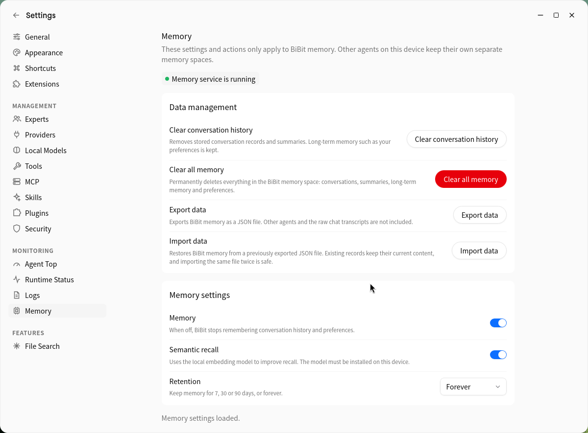

# Memory

With memory enabled, BiBit can remember your preferred name and usual preferences and refer to summaries of earlier conversations. This helps tailor future responses to your preferences and reduces the need to repeat yourself.

In a chat, you can ask BiBit to remember something like these:

- “Please remember to call me Xiaoming from now on.”
- “Please remember that I prefer concise answers.”
- “Please remember to prioritize vegetarian options when recommending restaurants.”

Once memory is enabled and the information is saved successfully, BiBit can refer to it in later chats. Do not store passwords, verification codes, or other sensitive information as memories.

Memory is not a complete chat history, and BiBit does not guarantee that it remembers every sentence. Save important information separately.

## Requirements

Go to **Settings → Monitoring → Memory** to view the page below. Before using this feature, make sure the page indicates that the memory service is running.

## Manage Memory Data

| Action | Description |
| --- | --- |
| Clear conversation history | Delete conversation records and related summaries stored in memory, while keeping long-term information such as your preferred name and preferences |
| Clear all memory | Delete all memories saved by BiBit, including your preferred name, preferences, conversation records, and summaries |
| Export data | Export saved memory to a JSON file for backup. This is not a complete chat history backup |
| Import data | Restore memory from a previously exported file. Existing records remain unchanged, and importing the same file again does not create duplicates |

**Clearing memory does not delete messages in chat windows or affect memories in other agent applications.** Clearing memory requires confirmation and cannot be directly undone. We recommend exporting a backup before clearing memory.

Exported files may contain personal preferences and conversation content. Keep them secure.

## View and Adjust Settings

After changing a setting, wait for the save confirmation. You do not need to restart BiBit. If saving fails, the page restores the previous setting.

| Setting | Description |
| --- | --- |
| Memory | Enable or disable automatic memory. When off, BiBit stops automatically recording and using memory; saved data is not deleted |
| Semantic recall | When enabled, helps BiBit find memories with related meanings. This requires a suitable local model; the option may not be available on every device |
| Retention | Choose 7 days, 30 days, 90 days, or forever for conversation records, preferences, and other memory |

Conversation summaries help BiBit follow recent discussions. They are kept for 7 days by default and are not affected by the retention setting above.

[Quick Start](../quickstart.md) · [FAQ](../faq.md) · [Documentation Home](../../index.md)
