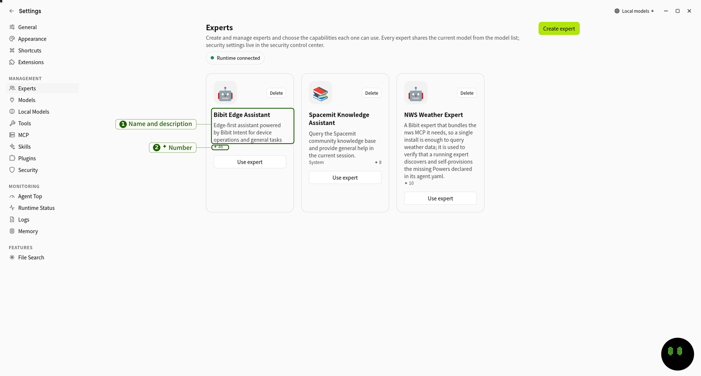
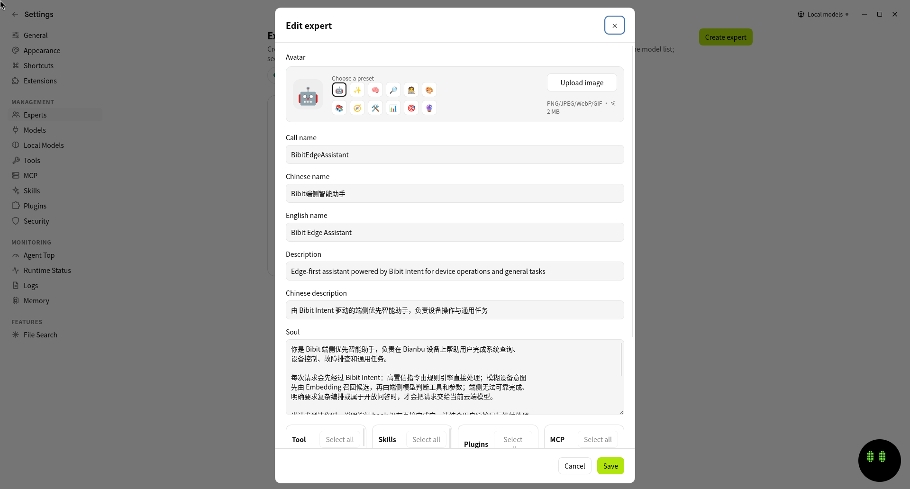

# Experts

Use **Settings → Management → Experts** to create and manage agent experts. Each expert has a name, avatar, description, Soul, and available tools, skills, plugins, and MCP servers. These settings determine what the expert can do in chat.

Experts created here use the current model from the [model list](runtime-providers.md). An existing expert with a fixed provider and model keeps using that configuration. A global model must still be selected before BiBit can send a new Runtime chat message.

Requirements: Runtime must be connected. If **Runtime unavailable** or **Host capability unavailable** appears at the top of the page, first check the extension and service status as described in [Runtime Management and Monitoring](runtime.md).

## Understand Expert Cards

| Information | Meaning |
| --- | --- |
| **Name and description** | Information shown when choosing an expert in chat |
| **System** | Included with BiBit or Runtime; reinstall or upgrade the Runtime package to restore it after deletion |
| **No global model selected** | The expert follows the global model and none is selected; add and select one in the [model list](runtime-providers.md) first |
| **✦ Number** | Number of enabled tools, skills, plugins, and MCP servers |
| **Use Expert** | Start a new conversation with this expert |
| **Delete** | Irreversibly delete the expert and its local configuration |

## Create an Expert

1. Click **Create Expert** on the **Experts** page.
2. Choose a preset avatar, or click **Upload Image**. PNG, JPEG, WebP, and GIF files up to 2 MB are supported.
3. Enter the identity information:

   | Field | Guidance |
   | --- | --- |
   | **Call Name** | An English identifier such as `ResearchAssistant` |
   | **Chinese Name**, **English Name** | Display names used in the chat interface for each language |
   | **Description**, **Chinese Description** | A sentence describing the expert's specialty |
   | **Soul** | Role, tone, and working requirements that influence the answer style |

4. Select the capabilities the expert may use under **Tools**, **Skills**, **Plugins**, and **MCP**. Items marked **Default capability, always on for every expert** or **Private to this expert; it cannot be turned off** are grey and cannot be deselected — the first is forced on by Runtime configuration, the second ships inside the expert's own package. Skills and MCP servers a plugin provides are listed only under Plugins; selecting the plugin enables all of them.
5. Click **Save** and wait for confirmation that the changes were saved. Tasks already in progress are not affected.

**Expected result:** The expert appears in the list with its capability count. Click **Use Expert** to start a conversation.

## Edit and Delete Experts

- Click an expert card to edit it, then click **Save**.
- If it reports **No global model selected**, add and select a model in the [model list](runtime-providers.md) first.
- Click **Delete** at the top right of the card and read the confirmation. Deletion cannot be undone. To restore a deleted system expert, reinstall or upgrade the Runtime package.

## Start a Chat with an Expert

Click **Use Expert** to create and open a new conversation. That conversation keeps the expert assigned when created. To use a different expert for another task, select one from the Experts page or a new chat.

The button may be unavailable because no global model is selected, Runtime is disconnected, or the current BiBit version does not provide the host action needed to create a conversation. Read the card and page messages first; if the problem is the model, use the [model list](runtime-providers.md) instead of editing the expert.

## Security Policies Are Managed Separately

This page manages the name, avatar, description, Soul, and capability selection. The global model is configured in the [model list](runtime-providers.md). Tool authorization, accessible file paths, and network access are managed under [Security](runtime-security.md). Editing an expert does not automatically relax these policies.

[Runtime Management and Monitoring](runtime.md) · [Models](runtime-providers.md) · [Quick Start](../quickstart.md) · [FAQ](../faq.md) · [Documentation Home](../../index.md)
