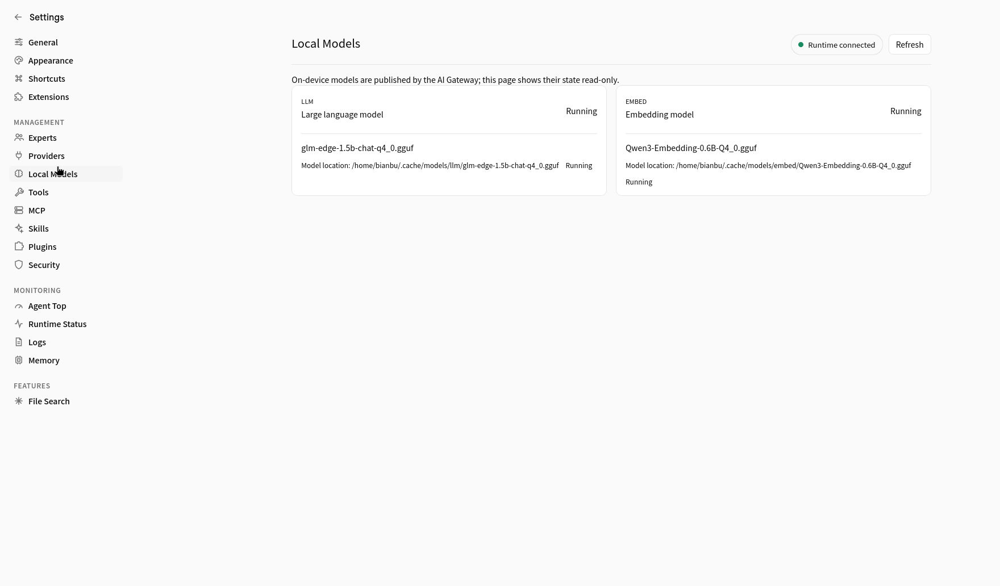

# Local Models

**Settings → Management → Local Models** shows model status on the device. This read-only page displays information from AI Gateway. It does not download, load, or unload models in BiBit.

Requirements: Runtime is connected and AI Gateway or Bibit Intent is reachable. If **Local model state unavailable** appears, check the relevant service and click **Retry**.

## Page Contents

The page has **Large Language Model** and **Embedding Model** sections. Each shows at most one model, with available information such as status, location, and download progress.

| Status | Meaning |
| --- | --- |
| **Running** | The model service is running |
| **Loading** | The model is starting or loading and is not yet usable |
| **Loaded** | The model is loaded and waiting or available for service calls |
| **Not loaded** | The model is registered but not running |
| **Unknown state** | The service returned no recognizable status |
| **Not registered in the AI Gateway** | No download or loading record exists for this model type on the device |

Queued or active downloads show a progress percentage, and status refreshes automatically. You can use other available features while a model is being prepared. Failure to read local model status does not directly interrupt chat.

## Common Situations

- **Invalid local model response**: Record the full message and click **Retry**. If it persists, check Runtime and AI Gateway versions and connectivity.
- Service unavailable: Check that AI Gateway or Bibit Intent is running, then click **Retry**.
- To download, start, stop, or switch models: Use AI Gateway management. This page only reports status and has no such buttons.
- **Not loaded** does not mean model files are damaged. The model may simply not be running. Check that the service has loaded it before use.

## Note

AI Gateway manages local models on your device. Opening this page does not trigger a model download in BiBit. Runtime relays the model names, locations, and download progress shown here. To confirm that a model is available, check its status in AI Gateway and the results you get in chat.

[Runtime Management and Monitoring](runtime.md) · [Experts](runtime-experts.md) · [Quick Start](../quickstart.md) · [FAQ](../faq.md) · [Documentation Home](../../index.md)
