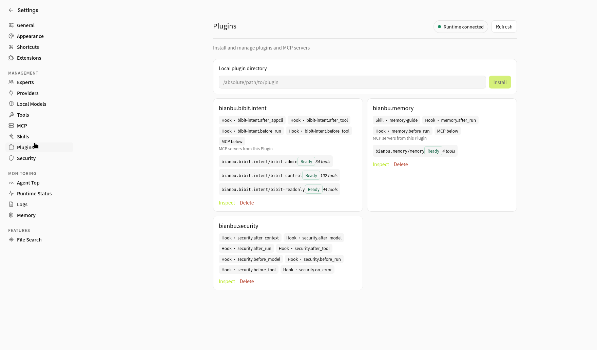

# Plugins

Use **Settings → Management → Plugins** to install and manage Runtime backend plugins and view their bundled MCP servers. These are different from BiBit Feature plugins.

Requirements: Runtime is connected and the plugin directory is on the device.

## Distinguish the Two Plugin Types

| Entry point | Managed object | Typical use |
| --- | --- | --- |
| **Settings → Management → Plugins** | Runtime backend plugins | Add agent tools, skills, hooks, or MCP servers |
| **Settings → Extensions** | BiBit Feature plugins | Install BiBit interface extensions such as Agent Hub or the Runtime console |

Install BiBit Feature plugins through **Settings → Extensions**. This page does not install, enable, or disable interface plugins.

## Install a Runtime Plugin

1. Locate the plugin directory on your device and note its absolute path, such as `/home/bianbu/plugins/my-plugin`.
2. Enter the path under **Local Plugin Directory**.
3. Click **Install**, wait for completion, and refresh the list.
4. Check the members and MCP status on the plugin card. Its tools and skills appear in their catalogs; expert configuration still controls their use.

**Expected result:** The plugin appears with its ID, member tags, or bundled MCP servers. Click **Inspect** for full metadata.

## Plugin Members and MCP

Cards may show:

- **Hook**: Logic attached to the Runtime lifecycle.
- **Skill**: Skills provided by the plugin.
- **Tool**: Tools provided by the plugin.
- **MCP servers from this Plugin**: Servers started by the plugin, with status and tool count. **tool count unknown** appears if the count cannot be read.

Bundled MCP status appears here rather than again in the standalone MCP list. View separately installed servers on the [MCP](runtime-mcp.md) page.

## Delete a Plugin

Before deleting a plugin, check that no running task is using it. Then click **Delete** on the plugin card. This removes the plugin and its members and may affect the tools, skills, and MCP servers it provides. You may need to update the configuration of experts that depend on those capabilities.

## Notes

- Install plugins only from trusted sources. Plugins can add capabilities that agents can use, so review their purpose and permissions before installation.
- If the page does not update after an operation finishes, refresh it to check the current state. Do not submit the same operation repeatedly.
- Being listed does not mean every member is usable. Check the card status, tool catalogs, and actual conversation results.
- If old content remains after updating Runtime or installing plugins, refresh first. If needed, fully quit and reopen BiBit.

[Runtime Management and Monitoring](runtime.md) · [MCP](runtime-mcp.md) · [Tools](runtime-tools.md) · [Skills](runtime-skills.md) · [Quick Start](../quickstart.md) · [FAQ](../faq.md) · [Documentation Home](../../index.md)
