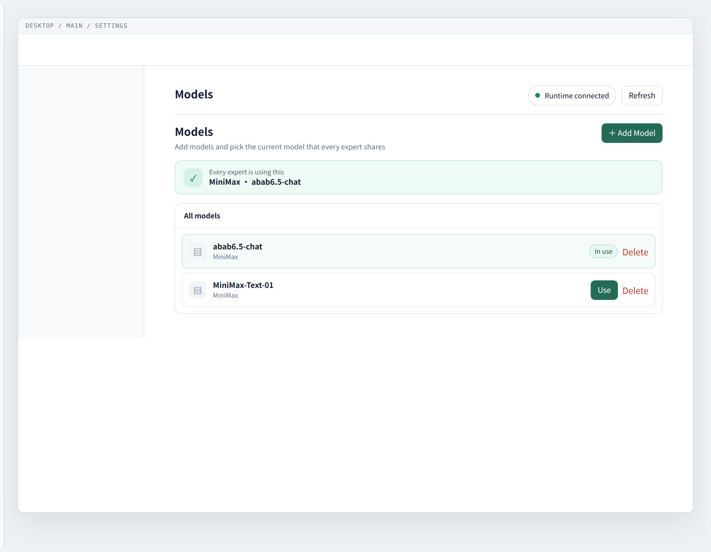
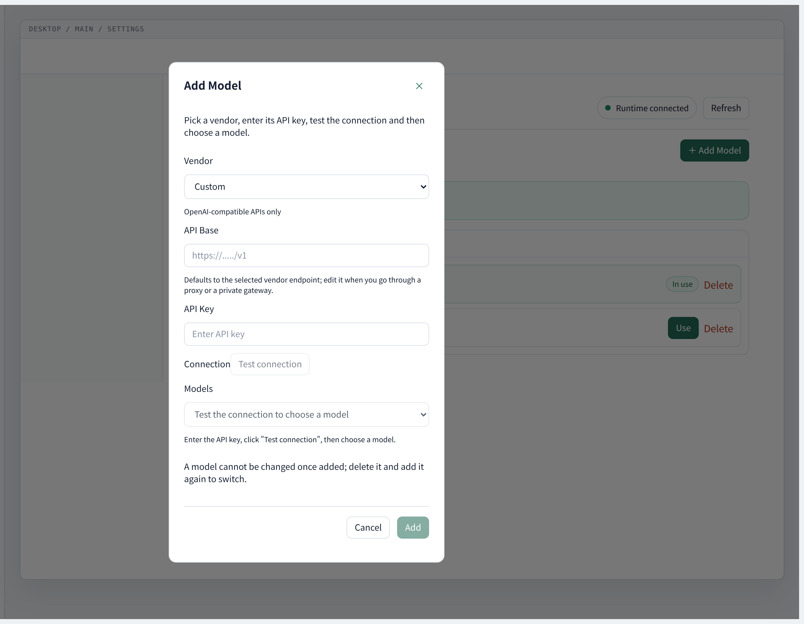

# Models

Under **Settings → Management → Models**, each model entry has its own endpoint and credentials. At most one entry is the **current model**. Experts without a fixed model use this entry.

Requirements: Runtime is connected. If the page reports **Runtime unavailable**, check extension and service status as described in [Runtime Management and Monitoring](runtime.md).

## Understand the Model List

| Information | Meaning |
| --- | --- |
| **Current global model** | Shows the model used by experts without a fixed model |
| **All models** | Every added model with its vendor and model name |
| **In use** | This entry is the current model |
| **Use** | Make this entry the current model |
| **Delete** | Remove the entry; add it again when needed |
| **No models yet** | Nothing has been added; start with **Add Model** |

The expert editor does not offer a per-expert model picker. Experts configured with a fixed provider and model keep using that pair. BiBit still needs a global model selected before it can send a new Runtime chat message.

## Add a Model

1. Click **Add Model**.
2. Pick a **Vendor**. **API Base** is filled in when the preset has a default endpoint. For **Custom** or **Azure OpenAI**, enter your own endpoint.
3. Adjust **API Base** when needed: for a proxy or a private gateway, enter the real endpoint (it usually ends with `/v1`).
4. Enter the **API Key**.
5. Click **Test connection**. When the dialog shows **Connected. Found N models, please choose one**, select a model from the **Model** dropdown. If the test fails, follow the prompt to check the endpoint and API key.
6. Click **Add**. If there is no current model, the new entry becomes current. Otherwise, click **Use** on the new entry if you want to switch to it.

**Expected result:** The model appears under **All models**. Only the current entry is marked **In use**.

## Switch the Current Model

Click **Use** on the target entry under **All models**. The list immediately marks that entry as **In use**. You do not need to refresh the page.

A turn already running is unaffected. Later turns that follow the global model use the new selection.

## Delete a Model

Click **Delete** on a row and confirm. Deleting the current model clears the global selection. Select another model, or add one if the list is empty, before sending a new Runtime chat message.

Deleting an entry removes its saved configuration. You can add the same model again by re-entering its settings. To change an entry, delete it and add it again.

## Notes

- An API key is sensitive. Never send it in chat or share a screenshot of the full key.
- **Test connection succeeded** only means the vendor accepted the credentials and returned a model list; it does not guarantee quota or later availability. Investigate failures with the message the page shows.
- For a local model service (Ollama, LM Studio) enter the address and port the device actually listens on, and keep **API Base** in sync when the port changes.
- Which local models actually run on the device is shown read-only on the [Local Models](runtime-models.md) page.

[Runtime Management and Monitoring](runtime.md) · [Experts](runtime-experts.md) · [Quick Start](../quickstart.md) · [FAQ](../faq.md) · [Documentation Home](../../index.md)
