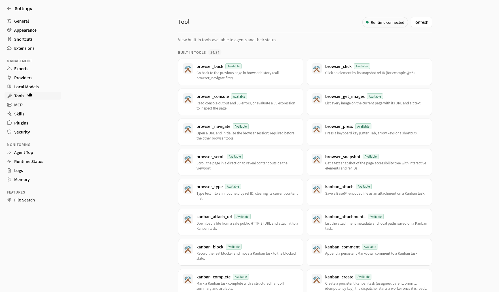

# Tools

Use **Settings → Management → Tools** to view Runtime's built-in agent tools and their current availability. This page is read-only. Enable and select tools in [Experts](runtime-experts.md) configuration.

Requirements: Runtime is connected.

## Understand Tool Cards

| Information | Meaning |
| --- | --- |
| **Built-in tools** and count | Number of tools in the catalog; if some are unavailable, available/total is shown |
| **Available** | Dependencies are satisfied; experts with this tool enabled can call it |
| **Unavailable** | Dependencies are missing, the environment is unsuitable, or configuration disallows it |
| **MCP · Plugin ID** | The tool comes from an MCP server or plugin rather than Runtime's built-in tools |
| Description | Purpose and limitations; when absent, an unavailability reason is shown |

## Use Tools

1. Open [Experts](runtime-experts.md) and select the expert.
2. Select the tools you need under **Tools**. Items marked **Default capability, always on for every expert** are automatically selected and locked.
3. Save the expert configuration.
4. Return to chat and describe the task. You normally do not need to name the tool.

**Expected result:** The expert can call tools according to its configuration. Confirmation, permission, or service requirements appear in the conversation when needed.

## If a Tool Is Unavailable

- Read the card to identify missing dependencies, environment requirements, or an MCP server or plugin that is not ready.
- If an MCP tool is unavailable, open [MCP](runtime-mcp.md) and check that its server is **Ready**. Check bundled MCP status under [Plugins](runtime-plugins.md).
- If **Unavailable** appears even though the expert has selected the tool, reopen the tool page to refresh it and check dependencies.
- Do not repeatedly call tools that make changes before understanding the impact. Check results and errors first.

## Difference from the Local Tool List

The [BiBit Local Tool List](tools.md) describes local tools that may be used to carry out natural-language requests on a device. This page shows the agent tool catalog available to experts. Names may overlap, but purposes and management entry points differ. To change an expert's tool access, edit that expert instead of trying to enable tools here.

[Runtime Management and Monitoring](runtime.md) · [Experts](runtime-experts.md) · [Skills](runtime-skills.md) · [Quick Start](../quickstart.md) · [FAQ](../faq.md) · [Documentation Home](../../index.md)
