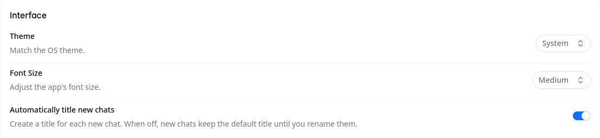
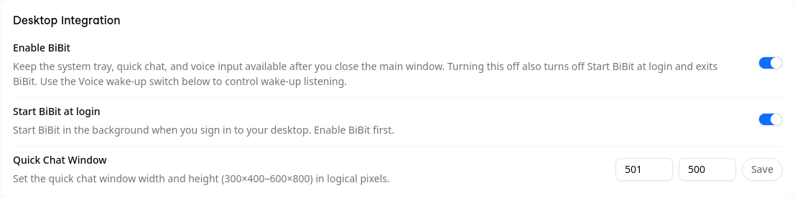
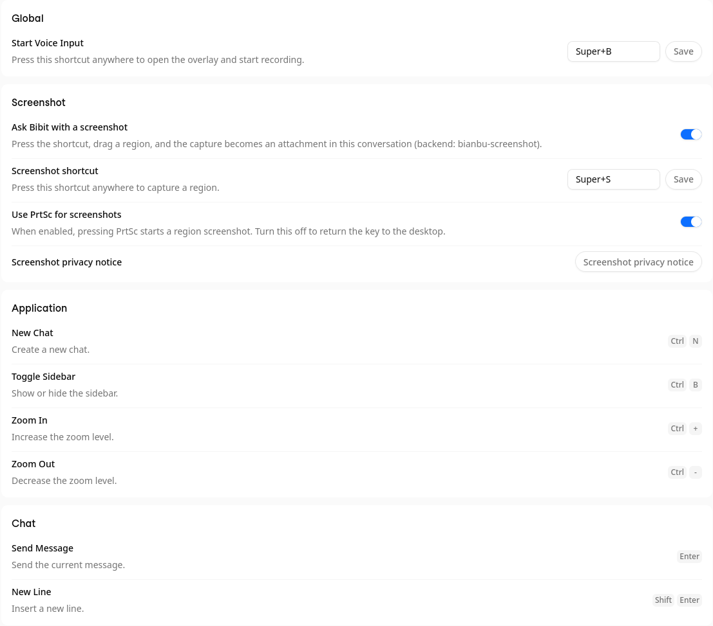

# Settings and Permissions

This page covers common settings, background operation, shortcuts, extension plugins, and permission prompts during tasks. For memory settings, see [Memory](memory.md).

## Handle Confirmations and Permission Requests

Some tasks call tools or change device state. When a permission card appears in a conversation or the sidebar marks a conversation as awaiting confirmation:

1. Open the conversation and review the requested operation, target, and parameters. Expand and read any details.
2. If it matches your intent, click **Allow Once** or the specific confirmation action provided.
3. If it does not match or you are unsure, click **Deny** or **Cancel**.
4. Wait for the card and task status to update, then check the result.

**Expected result:** Allowing lets the task continue. Denying does not authorize that operation, and the assistant may report that it cannot complete the step.

For example, when changing the time, you may see a confirmation titled **Disable automatic time synchronization?** Choose **Disable automatic sync and continue** to disable NTP synchronization and set the requested time. After a successful change, automatic synchronization remains off. Selecting **Cancel** leaves the requested change unexecuted.

If a permission prompt states that there is no automatic rollback, approval does not create a one-click recovery option. After a tool reports success, check the actual result, such as whether the correct file opened or the device state changed as requested.

## Adjust Common Settings

### Language, Theme, and Font Size

| Setting | Path and action |
| --- | --- |
| Interface language | **Settings → General → Language**; select a language |
| Light or dark theme | **Settings → Appearance → Theme**; select Light, Dark, or System |
| Text size | **Settings → Appearance → Font Size**; choose a comfortable size |
| Automatic titles | **Settings → Appearance → Automatically title new chats**; when off, new chats keep the default title until you rename them |

Figure: Theme, font size, and automatic title options under **Settings → Appearance**.

### Close the Window, Run in the Background, and Start BiBit at login

Open **Settings → General → Desktop Integration**.

| Action | Result |
| --- | --- |
| Keep **Enable BiBit** on and close the main window | The system tray and Quick Chat remain available |
| **Start BiBit at login** | Start BiBit in the background when you sign in to your desktop; Enable BiBit must be on first |
| Turn off **Enable BiBit** | Turn off **Start BiBit at login** and exit BiBit; the system tray, Quick Chat, and global shortcuts stop |
| Select Quit BiBit from the tray menu | Quit the running application; this differs from closing its main window |

If tasks are still running, read the prompt before quitting BiBit.

### Resize the Quick Chat Window

Open **Settings → General → Desktop Integration → Quick Chat Window**, enter the width and height, and use the page's save action. Supported dimensions are **300–600** wide and **400–800** high, in logical pixels. Correct out-of-range values before saving again.

Figure: Background operation, startup, and quick chat dimensions under **Settings → General → Desktop Integration**.

### View and Change Global Shortcuts

Open **Settings → Shortcuts** to view screenshot shortcuts and other shortcuts available in your version.

After changing a shortcut, check that it was saved and registered with the desktop. When **Use PrtSc for screenshots** is on, pressing PrtSc starts a region screenshot. Turn it off to return the key to the desktop. Global entry points require BiBit background operation and must not conflict with other desktop shortcuts.

Figure: Global shortcuts and **Use PrtSc for screenshots** under **Settings → Shortcuts**. Shortcuts are customizable; see [Shortcut Reference](#shortcut-reference) for defaults and explanations.

## Extensions: View and Manage Plugins

Open **Settings → Extensions** to view plugin names and status.

BiBit restarts automatically after a successful install, enable, disable, rollback, or uninstall. Send or save unfinished drafts and wait for important tasks to finish before making changes.

- **Pending restart**: Restart BiBit as prompted to apply the change.
- **Deactivate**: Keep plugin files and authorization so the plugin can be enabled again.
- **Uninstall plugin**: Remove installed plugin files and clear its activation state. Reinstalling BiBit does not restore the plugin automatically; install its package again.
- **Roll back**: Available only when a previous version can be restored. Follow the confirmation prompt.
- **Install plugin**: Click **Install plugin**, select a local `.bibit-plugin.tgz` package, and follow the prompts to complete installation. Install only packages with a clear source and purpose, and review the permissions they request first.

An **Active** plugin has loaded. If it depends on a separate service, that service must also be ready. If the plugin's page reports that the service is disconnected, check the service.

Runtime management and monitoring are a separate group of pages under **Management** and **Monitoring** in the settings sidebar. Install the Runtime management extension through **Extensions**. See [Runtime Management and Monitoring](runtime.md).

## Shortcut Reference

These are the Bianbu Desktop defaults. Global shortcuts can be changed; use the values shown under **Settings → Shortcuts**. **Super** is usually the Windows-logo key.

| Shortcut | Purpose | Scope |
| --- | --- | --- |
| **Enter** | Send the current message | Input box; selecting a Chinese IME candidate does not send immediately |
| **Shift+Enter** | Insert a line break | Input box |
| **Ctrl+N** | New chat | Within BiBit |
| **Ctrl+K** | Search conversations | Within BiBit |
| **Ctrl+B** | Show or hide the sidebar | Within BiBit |
| **Ctrl+,** | Open settings | Within BiBit |
| **Ctrl++ / Ctrl+-** | Increase or decrease answer text size | Within BiBit; sidebar and input text size remain unchanged |
| **Super+Shift+S** | Start a region screenshot | Global; screenshot support and shortcut registration are required |
| **PrtSc / Print** | Start a BiBit region screenshot | Only when **Use PrtSc for screenshots** is on and the shortcut is registered |

With **Use PrtSc for screenshots** off, the desktop handles Print and BiBit does not take a screenshot. Use **Super+Shift+S** to start a BiBit region screenshot directly.

[Quick Start](../quickstart.md) · [FAQ](../faq.md) · [Documentation Home](../../index.md)
