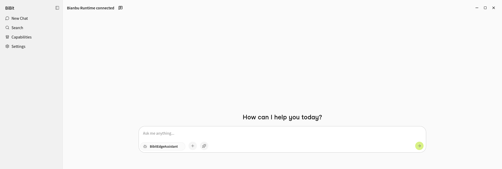

# Quick Start

This guide helps Bianbu Desktop users who have already installed BiBit start their first conversation.

## Open BiBit

1. Find and open **BiBit** in the Bianbu application menu.
2. If BiBit is running in the background, you can also right-click its system tray icon and select **Open Main Window**. If the floating icon is visible, double-click it to open the main window.
3. Check the connection status at the top of the window. Wait for **Bianbu Runtime connected**, or a connected status for your current assistant service, before sending a question.

If the status stays at “Starting,” “Disconnected,” or “Connection failed,” follow [Frequently Asked Questions](faq.md).

Figure: The main window with New Chat, expert selection, and the message input box.

## Send Your First Question

1. Click **New Chat** in the sidebar.
2. Check the assistant name below the input box. Use the default assistant if one is available. If you see “Select an assistant,” click that area and select an available expert.
3. Enter the following in the input box:

   > Please describe in three sentences what you can help me do.

4. Press **Enter**, or click the send button at the lower right of the input box.
5. Wait for the response to finish. Then continue the conversation with a follow-up such as “Please give me an example of how you can help with everyday office tasks.”

**Expected result:** Your question and the response appear in the conversation, and the conversation appears in the sidebar. Start a new chat for a different topic to keep its context separate.

## Read and Copy Answers

| What you want to do | Action |
| --- | --- |
| Enter multiple lines | Press **Shift+Enter** to insert a line break |
| Copy an answer | Wait for the answer to finish, then click the copy button below it |
| Return to an earlier chat | Click its title in the sidebar |

## What to Do Next

| What you want to do | Guide |
| --- | --- |
| Select experts, use temporary skills, or organize conversations | [Chat and Conversation Management](modules/chat.md) |
| Attach files, ask about screenshots, search local files, or read references | [Files and Reference Materials](modules/files.md) |
| Send messages from the tray or floating icon | [Quick Chat](modules/quick-chat.md) |
| Install, update, or upload capabilities | [Agent Hub](modules/agent-hub.md) |
| Manage memory settings, clear saved memories, or export memory data | [Memory](modules/memory.md) |
| Change appearance, desktop integration, shortcuts, or plugins, or handle approvals | [Settings and Permissions](modules/settings.md) |
| Manage Runtime experts, model services, capabilities, or security, or view status | [Runtime Management and Monitoring](modules/runtime.md) |

Available features may vary by version or device. Follow the interface on your device. For help, start with [Frequently Asked Questions](faq.md).

[Documentation Home](../index.md)
