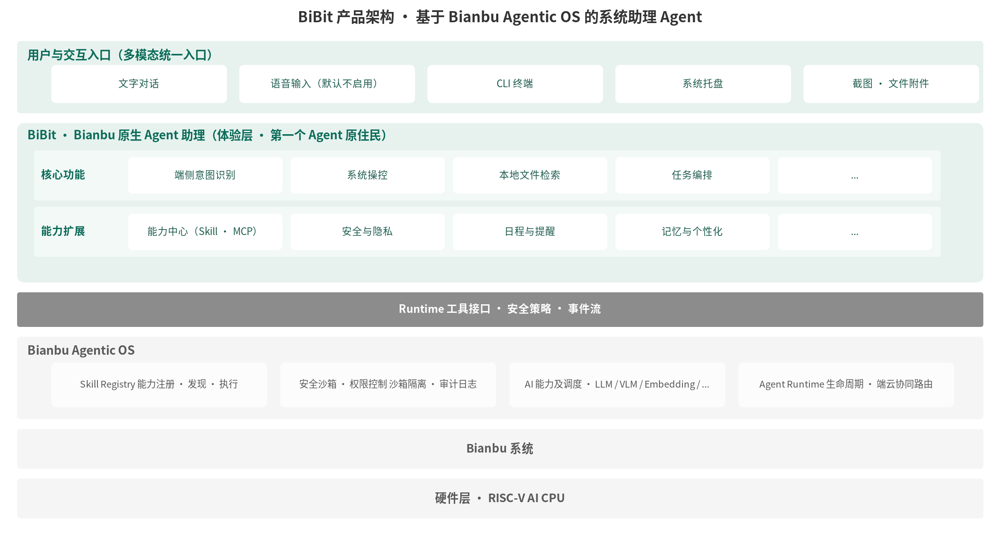

# Bianbu Agentic

**Bianbu Agentic** 是面向 SpacemiT K 系列设备的智能体系统底座，致力于让智能体运行得更好、更稳、更安全。

## BiBit 桌面助理

BiBit 是 Bianbu Agentic 的桌面助理和用户交互入口，整合桌面对话、专家选择、设备操作、本地文件检索与可扩展能力。

图中语音输入标注为默认不启用。当前桌面版本的快速对话仅支持键盘输入。

安装与使用说明见 [BiBit 用户指南](bibit/index.md)。
