# 能力中心

**能力中心** 用于查看、安装和管理 BiBit 上的能力。

使用条件：侧栏显示 **能力中心**。该入口由 Agent Hub 插件提供。如果入口不见了，请在 **设置 → 扩展** 中确认插件已安装并启用，并按提示重启 BiBit。服务不可用时，先阅读完整错误提示，无法自行解决时可到开发者社区提问。

点击 **能力中心** 后，可以切换三个页签：

| 页签 | 用途 |
| --- | --- |
| 我的能力 | 查看 **Agent** 控件所选安装目标的已安装能力和自动检测到的本地自定义资源 |
| 能力市场 | 查找能力、查看版本，并为所选 Agent 安装或更换版本 |
| 设置 | 管理上传自定义资源所需的 API Key（APC，即开发者平台的能力发布服务）|

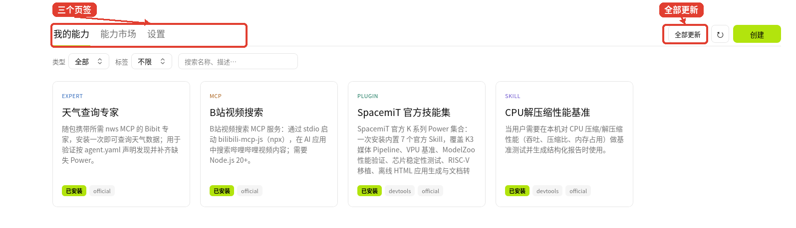

## 查找并安装能力

1. 打开 **能力市场**。若页面显示 **Agent** 控件，可用它选择安装目标；只有 BiBit 一个目标时，页面可能不显示该控件。给 BiBit 使用时选择 **bibit**；这里的目标选择不会改变聊天中选定的专家。

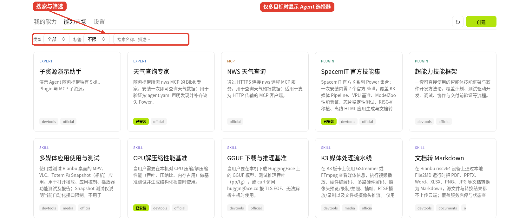

如果环境提供多个安装目标，可展开 **Agent** 控件切换。下图为多目标环境示例：

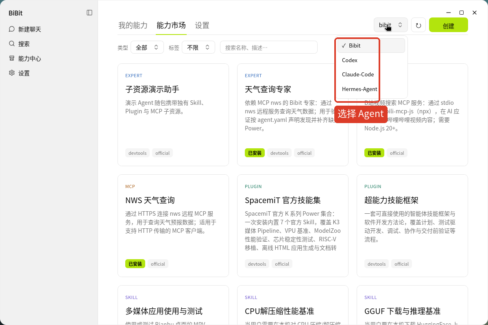

2. 在 **搜索名称、描述…** 输入框中搜索，需要时使用 **类型**、**标签** 筛选。

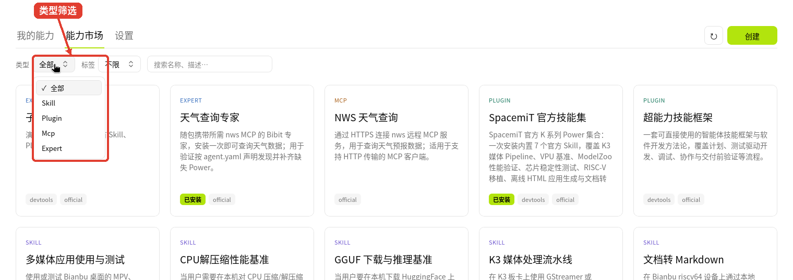

3. 点击能力卡片查看说明、版本和安装状态。未安装的市场能力还可直接点击卡片上的 **添加能力**，会直接按卡片上显示的版本安装。

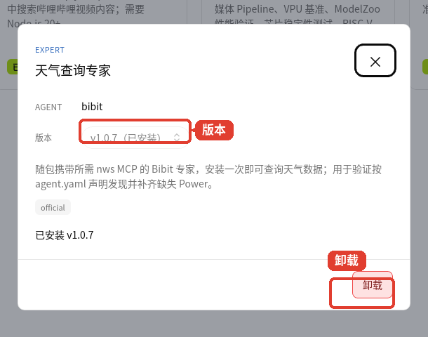

4. 首次安装时，在详情中选择版本并点击 **安装**。更换已安装版本时，点击 **更新** 或 **降级**，核对提示后点击 **确认更新** 或 **确认降级**。

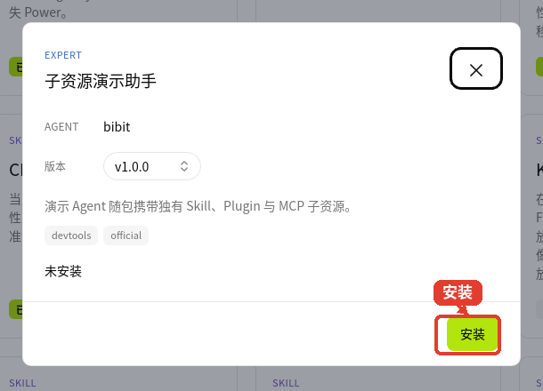

5. 等待安装结束，页面显示 **安装完成** 后，到 **我的能力** 查看安装结果。需要重新读取时，使用 **刷新**。

**预期结果：** 能力安装到选定的 Agent，页面显示实际安装版本。技能、插件、MCP 和专家各有用途，安装成功后的使用入口取决于资源类型与当前服务支持；需要在聊天中选择专家时，按[选择专家](chat.md#选择专家)操作。

## 更新与移除能力

- 更换单个能力的版本：在 **能力市场** 打开详情，选择版本，再按 **更新／降级** 和后续确认按钮操作。
- 批量更新：进入 **我的能力**，点击 **全部更新**，在弹窗中确认要更新的 Agent，再执行。

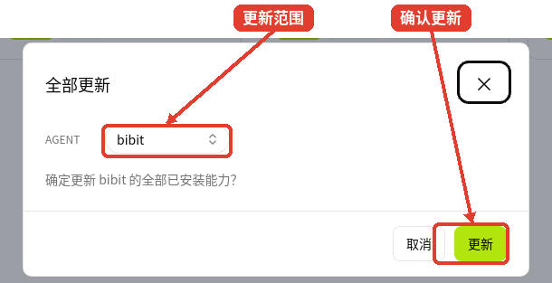

- 卸载已安装的市场能力：打开详情，选择已安装版本，点击 **卸载 → 确认卸载**，核对目标和资源名称。

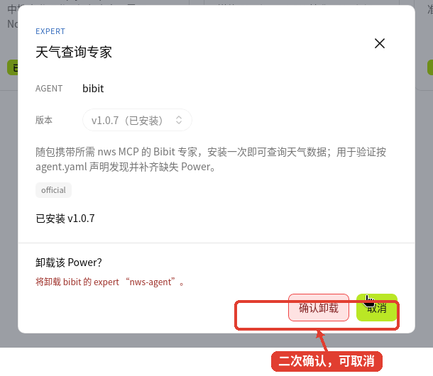

- 对标记为 **自定义** 的资源，详情中有 **删除**；确认后会删除本地已安装的文件，且不可恢复；需要保留时先自行备份。

出现“操作结果待确认”“无法确认安装状态”等提示时，先刷新读取实际状态，避免立即重复安装、卸载或更新。页面提示未授权或不支持该操作时，记录完整提示，到开发者社区提问。

## 获取 APC API Key

上传自定义资源需要 APC API Key。这个 Key 由进迭时空开发者平台提供，获取方式：

1. 访问 [SpaceMiT 开发者平台](https://developer.spacemit.com)，进入个人中心的 **开发者 API Key** 页面。未登录时会先进入统一认证中心，按页面提示登录开发者账号。

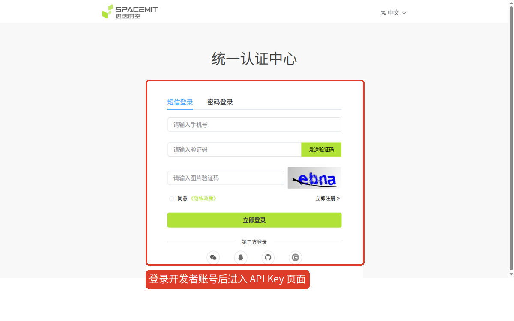

2. 登录后页面即为 **开发者 API Key** 管理页，按页面提示新建或查看 Key，并复制完整内容。Key 是敏感凭证，不要粘贴到聊天、截图或公开文档中。

3. 回到 BiBit，在 **能力中心 → 设置** 中粘贴并保存该 Key，具体步骤见下一节。

## 创建能力草稿

点击页面右上角的 **创建**，BiBit 会打开新聊天并在输入框中填入创建能力的提示草稿。补全资源类型和具体要求，检查内容后再发送；点击“创建”本身不会发送消息，也不代表资源已经生成。入口不可用时按页面提示处理；若提示需要先清空输入框，先保存当前草稿再重试。

## 上传已有自定义资源

使用条件：**我的能力** 中已有标记为 **自定义** 的资源，资源需满足 **Power 格式 v2**（不符合时按页面提示处理后再试），并有可用的 API Key。上传会把该资源提交到开发者平台，提交前确认资源内容适合公开。

1. 进入 **能力中心 → 设置**，在 **APC API Key** 输入框填写可用的 APC API Key，点击 **保存 Key**。等待成功提示，确认所需 Key 显示 **已启用**；未启用时点击 **启用**。已保存的 Key 以遮蔽形式显示，也可用 **删除** 移除。

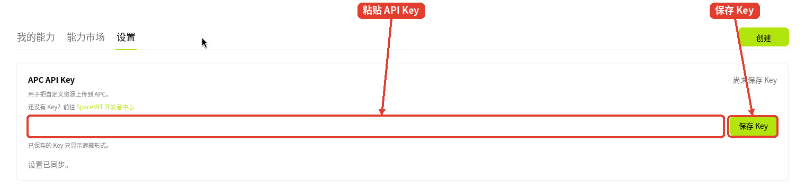

2. 返回 **我的能力**，确认 **Agent** 目标，打开自定义资源详情，点击 **上传**。

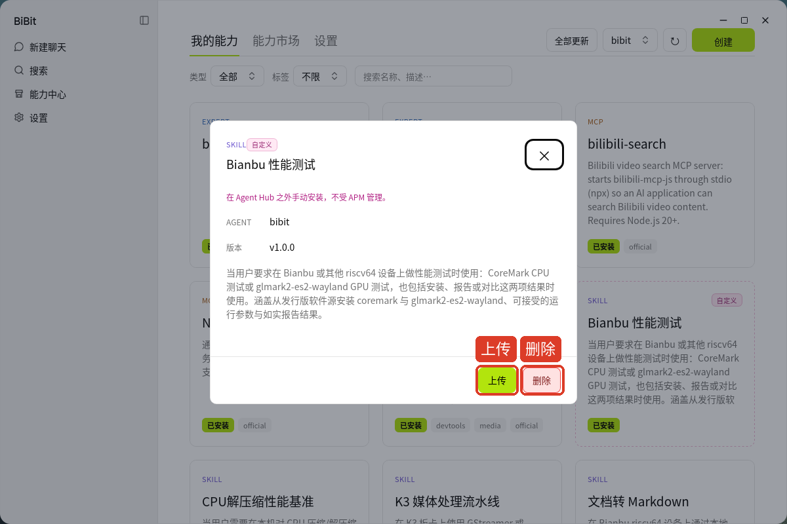

3. 填写必填的 **发布说明**（最多 200 个字符），点击 **上传到 APC**，等待上传完成提示。

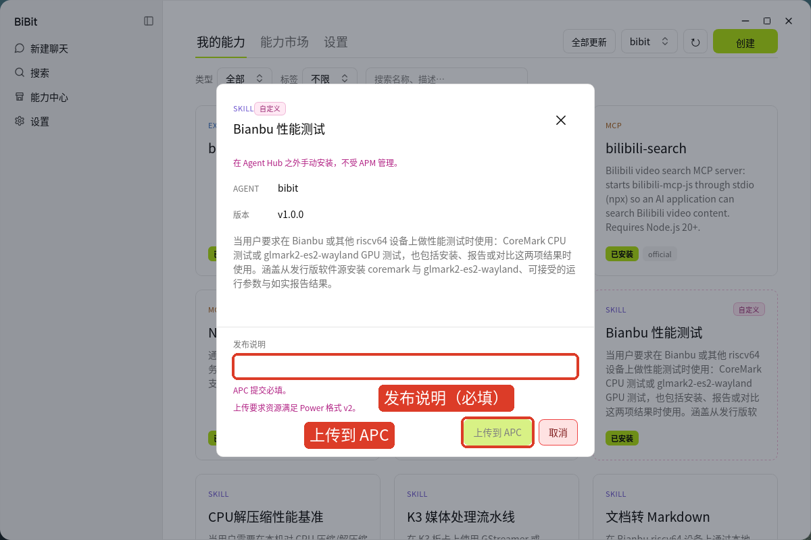

这里的 **设置** 是能力中心页面内的页签（不是左侧栏的设置）。上传从已有自定义资源的详情发起；缺少 Key 或资源格式不符合要求时，按提示补齐后再试。

[快速开始](quickstart.md) · [常见问题](faq.md) · [文档首页](index.md)
