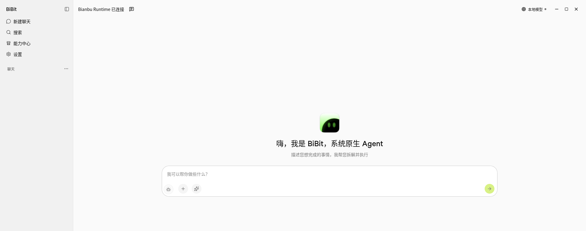

# 快速开始

本页面向已经安装 BiBit 的 Bianbu 桌面用户，带你完成第一次对话。

## 打开 BiBit

1. 在 Bianbu 的应用菜单中查找并打开 **BiBit**。
2. 如果 BiBit 已在后台运行，也可以右键点击系统托盘中的 BiBit 图标，选择 **打开主窗口**；桌面上有悬浮球时，双击小球也能打开主窗口。
3. 查看窗口上方的连接状态。窗口上方显示 **Bianbu Runtime 已连接**（部分设备显示“已连接”）后，即可开始提问。

如果一直显示“正在启动”“未连接”或“连接失败”，先按[常见问题](faq.md)处理。

图：主窗口中的新建聊天入口、专家选择和消息输入框。

## 发送第一个问题

1. 点击左侧 **新建聊天**。
2. 查看输入框下方的助手名称。已有默认助手时，直接使用即可；显示“请选择助手”时，点击该处选择专家。
3. 在输入框中输入：

   > 请用三句话介绍你能帮助我完成哪些事情。

4. 按 **Enter**，或点击输入框右下方的发送按钮。
5. 等待回答逐步显示。回答结束后，可以在同一会话继续提问，例如“请举一个日常办公的例子”。

**预期结果：** 问题和回答出现在对话区，左侧会话列表中出现这次聊天。新话题可以另建聊天，避免与原来的上下文混在一起。

## 阅读和复制回答

| 想做什么 | 操作 |
| --- | --- |
| 输入多行文字 | 按 **Shift+Enter** 换行 |
| 复制回答 | 等回答结束，点击该条回答下方的复制按钮 |
| 回到之前的聊天 | 点击左侧会话标题 |

## 接下来可以做什么

| 想做什么 | 阅读指南 |
| --- | --- |
| 选择专家、临时使用技能、整理历史会话 | [对话与会话管理](chat.md) |
| 上传文件、截图提问、检索本地文件或阅读参考资料 | [文件与资料](files.md) |
| 从托盘或悬浮球打开快速对话、发送消息 | [快速对话](quick-chat.md) |
| 安装、更新或上传能力 | [能力中心](agent-hub.md) |
| 调整记忆、清除或导出记忆数据 | [记忆](memory.md) |
| 调整外观、桌面入口、快捷键或插件，处理权限确认 | [设置与权限](settings.md) |
| 管理 Runtime 专家、模型服务、能力、安全策略或查看运行状态 | [Runtime 管理与监控](runtime/index.md) |

不同版本或设备提供的功能可能略有差异，请以实际界面为准。遇到问题可先查看[常见问题](faq.md)。

[BiBit 用户指南](index.md)
