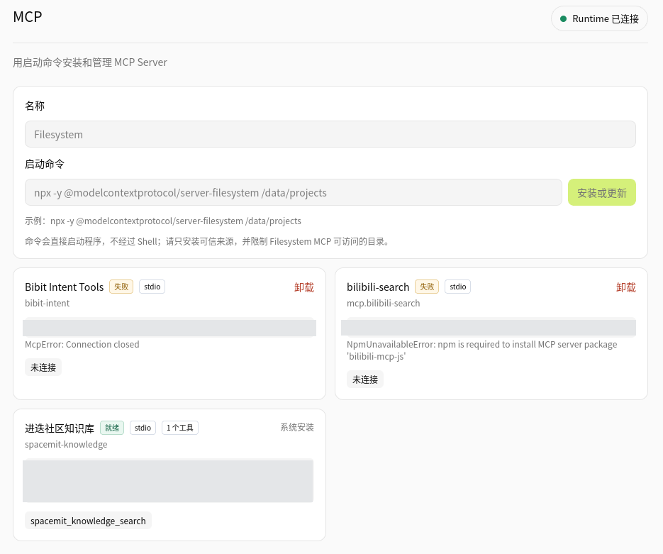

# MCP

**设置 → 管理 → MCP** 用于安装和管理独立的 MCP Server。MCP Server 可以向 Agent 提供额外工具；安装或更新会改变 Runtime Worker 的启动内容。

使用条件：Runtime 已连接，并且设备可以运行 MCP 所需的命令和依赖。



## 安装或更新 MCP Server

1. 在 **名称** 中填写便于识别的名称，例如 `Filesystem`。
2. 在 **启动命令** 中填写启动 Server 的完整命令。示例：

   ```text
   npx -y @modelcontextprotocol/server-filesystem /data/projects
   ```

3. 点击 **安装或更新**，等待页面重新读取状态。首次安装可能需要下载依赖，**准备中** 可能持续一到两分钟。
4. 状态变为 **就绪** 后，查看卡片中的工具数量或工具名称。

**预期结果：** MCP Server 出现在列表中，状态为 **就绪**，并显示可用的工具数量或工具名称。然后到[专家](experts.md)页，在 **MCP** 区域为需要使用这些工具的专家勾选对应 Server。

## 看懂状态

| 状态 | 含义与处理 |
| --- | --- |
| **未加载** | Runtime 还没有启动该 Server；点击页面顶部 **刷新** 可重试 |
| **准备中** | 正在启动并握手；首次安装依赖时可能需要更久 |
| **就绪** | Server 已连接，可以提供工具 |
| **降级** | Server 部分可用；查看卡片上的原因和工具列表 |
| **失败** | 启动失败；查看错误原因，修正命令或依赖后重试 |
| **已停止** | Server 当前没有运行 |
| **未知** | 暂时读不到加载状态；点击 **刷新** 重试 |

页面顶部的 **刷新** 会同时重新读取目录和执行健康检查，所以 MCP 和插件页不需要再找第二个刷新按钮。

## 卸载 MCP Server

打开 Server 卡片上的 **卸载**，阅读确认提示后执行。标记为 **系统安装** 的 Server 不能在这里卸载。卸载会移除该 Server 及其提供的工具；依赖这些工具的专家配置可能需要同步调整。

## 插件自带的 MCP

插件随包提供的 MCP 归插件所有，在[插件](plugins.md)页随插件显示状态。MCP 页只管理独立安装的 MCP Server，不会重复列出插件自带的 MCP。看到“插件随包提供的 MCP 在插件页显示”时，这是正常提示。

## 注意事项

- 启动命令会直接启动程序，不经过 Shell。只安装可信来源，并限制 Filesystem MCP 可访问的目录。
- 不要把密码、令牌或其他敏感信息直接写进启动命令；需要凭据时，使用服务提供的安全配置方式。
- 安装、更新和卸载完成后如果页面没有更新，先刷新读取实际状态，不要立即重复安装。
- MCP Server 显示 **就绪** 代表连接成功，不代表它提供的每个工具都适合当前专家；仍需在专家配置中选择。

[Runtime 管理与监控](index.md) · [插件](plugins.md) · [专家](experts.md) · [快速开始](../quickstart.md) · [常见问题](../faq.md) · [文档首页](../index.md)
