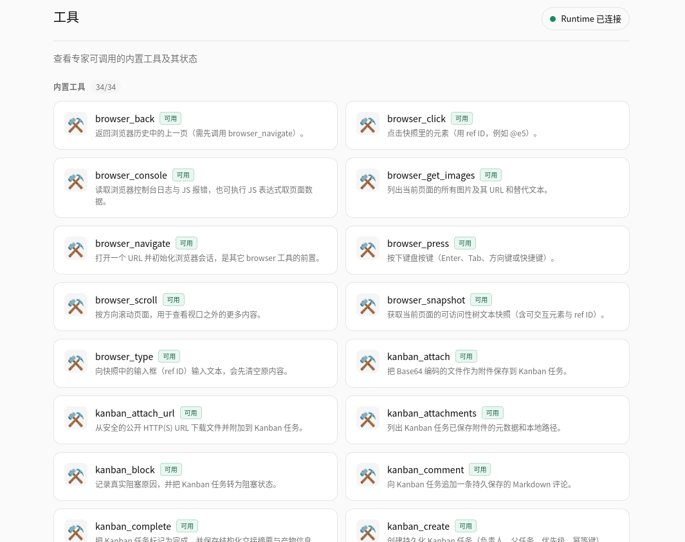

# 工具

**设置 → 管理 → 工具** 用于查看 Runtime 提供给 Agent 的内置工具，以及这些工具当前是否可用。页面只读显示，工具的启用和选择在[专家](experts.md)配置中完成。

使用条件：Runtime 已连接。

## 看懂工具卡片

| 页面信息 | 含义 |
| --- | --- |
| **内置工具** 和数量 | 当前目录中的工具数量；有不可用项时显示“可用数/总数” |
| **可用** | 工具依赖已满足，可以被已启用它的专家调用 |
| **未启用** | 工具依赖缺失、运行环境不满足，或当前配置不允许使用 |
| **MCP · 插件 ID** | 该工具来自 MCP Server 或插件，而不是 Runtime 内置工具 |
| 工具说明 | 工具用途和限制；说明缺失时会显示不可用原因 |

## 使用工具

1. 打开[专家](experts.md)，选择要使用工具的专家。
2. 在 **工具** 区域勾选需要的工具。标记为 **默认能力，所有专家固定启用** 的条目会自动勾选并锁定。
3. 保存专家配置。
4. 回到聊天，直接描述要完成的任务。通常不需要说出工具名称。

**预期结果：** 专家可以按配置调用工具；如果工具需要确认、权限或额外服务，对话中会显示对应提示。

## 工具不可用怎么办

- 先查看卡片上的说明，确认是依赖缺失、运行环境不满足，还是工具来自尚未就绪的 MCP 或插件。
- MCP 工具不可用时，到 [MCP](mcp.md) 页检查 Server 是否 **就绪**；插件自带 MCP 的状态到[插件](plugins.md)页查看。
- 工具显示 **未启用** 但专家中已经勾选时，重新打开工具页刷新，确认依赖是否仍然缺失。
- 不要在未确认影响时反复调用修改类工具；先检查实际执行结果和错误提示。

## 与本地工具列表的区别

[BiBit 本地工具列表](../tools.md) 说明的是用户一句话操作设备时可能使用的本地工具；本页展示的是 Agent 运行时提供给专家的工具目录。两者可能名称相近，但用途和管理入口不同。要调整某个专家能不能使用工具，请编辑专家配置，而不是在本页点击启用。

[Runtime 管理与监控](index.md) · [专家](experts.md) · [技能](skills.md) · [快速开始](../quickstart.md) · [常见问题](../faq.md) · [文档首页](../index.md)
