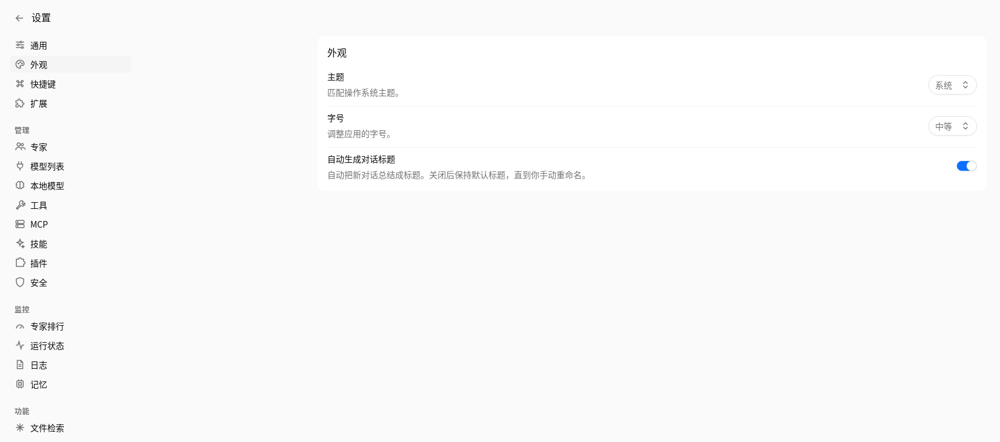
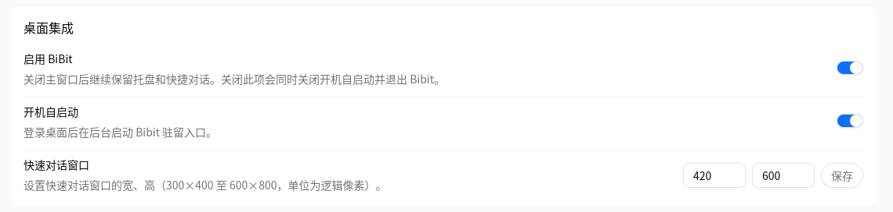
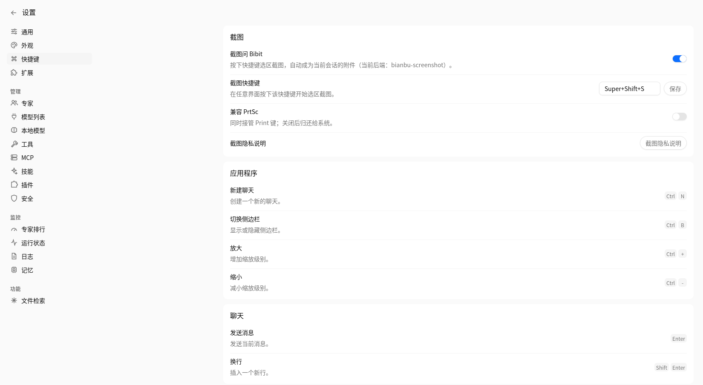

# 设置与权限

本页介绍常用设置、桌面驻留、快捷键、扩展插件，以及任务执行时的权限确认。记忆设置参阅[记忆](memory.md)。

## 处理操作确认与权限请求

有些任务会调用工具，或需要修改设备状态。对话中出现醒目的权限确认卡片、会话列表出现待确认标记时：

1. 打开该会话，查看请求执行的操作、目标和参数；可展开的详情应先读完。
2. 确认符合自己的意图后，点击 **允许一次**，或卡片提供的具体确认按钮。
3. 不符合预期或无法判断时，点击 **拒绝** 或 **取消**。
4. 等待卡片和任务状态更新，再查看结果。

**预期结果：** 允许后任务继续执行；拒绝后，对应操作不获此次授权，助手可能提示无法继续该步骤。

例如，修改时间时可能出现 **需要关闭自动校时**：点击 **关闭自动校时并继续** 后，会关闭 NTP 自动校时并设置指定时间，成功后自动校时仍保持关闭。选择 **取消** 则不执行这次修改。

权限请求中明确说明没有自动回滚时，允许操作不意味着可以一键恢复。工具显示成功后，还应检查实际结果，例如目标文件是否正确打开、设备状态是否按要求改变。

## 调整常用设置

### 语言、主题与字号

| 想调整什么 | 路径与操作 |
| --- | --- |
| 界面语言 | **设置 → 通用 → 语言**，选择所需语言 |
| 明暗主题 | **设置 → 外观 → 主题**，选择浅色、深色或系统选项 |
| 文字大小 | **设置 → 外观 → 字号**，选择适合阅读的大小 |
| 自动生成标题 | **设置 → 外观 → 自动生成对话标题**；关闭后，新会话保留默认标题，直到手动重命名 |

图：**设置 → 外观** 中的主题、字号和自动生成对话标题选项。

### 关闭窗口、后台驻留与开机自启动

进入 **设置 → 通用 → 桌面集成**。

| 操作 | 结果 |
| --- | --- |
| 保持“启用 BiBit”开启并关闭主窗口 | 继续保留托盘和快速对话 |
| 开启“开机自启动” | 登录桌面后在后台启动 BiBit；该设置需要先启用 BiBit |
| 关闭“启用 BiBit” | 同时关闭自启动并退出 BiBit，托盘、快速对话和全局快捷键停止 |
| 托盘菜单选择“退出 BiBit” | 退出当前 BiBit 程序；与关闭主窗口不同 |

如果还有任务正在进行，退出前阅读提示。

### 调整快速对话窗口

进入 **设置 → 通用 → 桌面集成 → 快速对话窗口**，填写宽度、高度并按页面提供的保存按钮确认。支持的尺寸范围是宽 **300–600**、高 **400–800**，单位为逻辑像素。若提示范围错误，调整数值后重新保存。

图：**设置 → 通用 → 桌面集成** 中的驻留、自启动和快速对话窗口尺寸。

### 查看和修改全局快捷键

进入 **设置 → 快捷键**，查看截图快捷键及当前版本提供的其他快捷键。

修改后，确认页面提示已保存，并检查是否已被桌面环境注册。**兼容 PrtSc** 开启时还会接管 Print 键；关闭后归还给系统。全局入口需要 BiBit 驻留功能启用，且不能与桌面环境中的其他快捷键冲突。

图：**设置 → 快捷键** 中的全局快捷键和 **兼容 PrtSc** 选项。快捷键可自定义，默认值与说明见[常用快捷键速查](#常用快捷键速查)。

## 扩展：查看和管理插件

进入 **设置 → 扩展**，查看插件名称和状态。

安装、启用、停用、回滚或卸载成功后，BiBit 会自动重新启动。操作前先发送或保存未完成的草稿，等待重要任务结束。

- **待重启**：按提示重新启动 BiBit，使变更生效。
- **停用**：保留插件文件和授权，之后可以重新启用。
- **卸载插件**：删除已安装的插件文件并清除启用状态；重新安装 BiBit 不会自动恢复该插件，需要重新安装插件包。
- **回滚**：仅在有可回滚版本时提供，按界面提示确认。
- **安装插件**：点击 **安装插件**，选择本地 `.bibit-plugin.tgz` 插件包，按界面提示完成安装。请只安装来源明确、用途清楚的插件包，并在安装前确认其需要的权限。

插件显示 **已启用**，说明它已加载。如果该插件依赖独立服务，还需要对应服务就绪。页面提示服务未连接时，请检查该服务。

Runtime 管理与监控是设置中的另一组页面，入口在侧栏的 **管理** 和 **监控** 分组；Runtime 管理扩展的安装仍在本页的 **扩展** 中完成。详细操作参阅[Runtime 管理与监控](runtime/index.md)。

## 常用快捷键速查

以下是 Bianbu 桌面的默认值；全局快捷键可被修改，实际值以 **设置 → 快捷键** 为准。**Super** 通常是键盘上的 Windows 标志键。

| 快捷键 | 用途 | 生效范围 |
| --- | --- | --- |
| **Enter** | 发送当前消息 | 输入框内；中文输入法选词期间不会直接发送 |
| **Shift+Enter** | 输入换行 | 输入框内 |
| **Ctrl+N** | 新建聊天 | BiBit 应用内 |
| **Ctrl+K** | 搜索会话 | BiBit 应用内 |
| **Ctrl+B** | 显示或隐藏侧边栏 | BiBit 应用内 |
| **Ctrl+,** | 打开设置 | BiBit 应用内 |
| **Ctrl++ / Ctrl+-** | 放大或缩小回答正文的字号 | BiBit 应用内；不改变侧栏和输入框字号 |
| **Super+Shift+S** | 开始选区截图 | 全局，需要截图功能和快捷键注册生效 |
| **PrtSc / Print** | 开始 BiBit 选区截图 | 仅在开启“兼容 PrtSc”并注册生效时 |

未开启 **兼容 PrtSc** 时，Print 键由桌面系统处理，不会把截图加入 BiBit。可以直接使用 **Super+Shift+S** 发起 BiBit 选区截图。

[快速开始](quickstart.md) · [常见问题](faq.md) · [文档首页](index.md)
