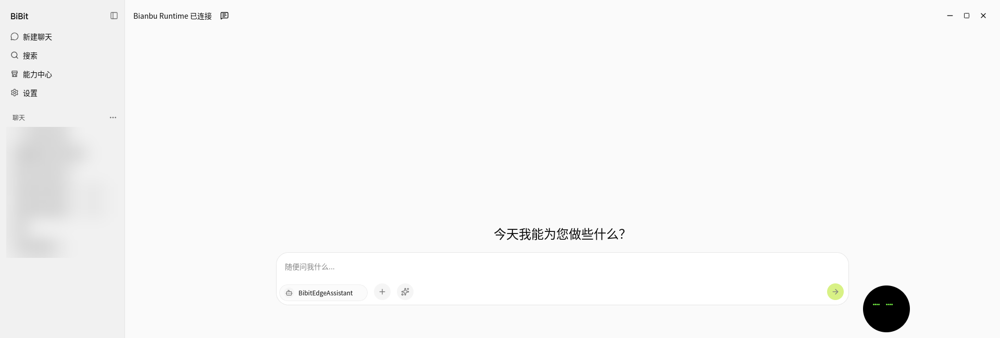
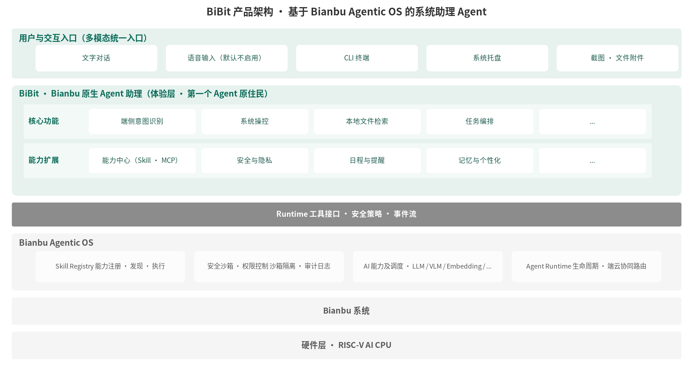

# BiBit — Bianbu 的原生 Agent 助理

> 运行在 Bianbu 桌面上的系统 Agent「原住民」——端侧优先的系统级 AI 助理，让每一位用户都能用自然语言操控设备，并完成用户下达的任务。

---

## 1. BiBit 是什么

**BiBit 是基于 Bianbu Agentic OS 开发的系统助理 Agent，是 Bianbu 系统的原生 AI Agent 助理。**

它不是外挂的语音助手或搜索框，而是**内建在系统里、随系统分发、开机即用**的系统级 Agent 入口。BiBit 专注于「体验层交互」，将运行时、安全、Skill 基础设施交给底座的 Bianbu Agentic OS——这也是 BiBit 能够随系统轻量分发、开机即用的原因。

BiBit 运行在 Bianbu + Agent OS 之上，核心能力如下：

- **系统原生 Agent**：用户把系统管理与操作需求托管给 BiBit，由它完成意图识别、任务编排与执行；
- **社区知识的智能入口**：接入进迭时空社区知识库，社区文档、教程、FAQ 等资料为 BiBit 的回答提供参考，并展示资料来源与引用；
- **人机交互的统一入口**：通过桌面对话或命令行与 Agent Computer 交互；
- **能力可扩展**：调用自定义 Skill、MCP、专家等能力，持续扩充自定义能力。

### 为什么叫 BiBit

**Bi** 取自 **Bianbu**，**Bit** 是信息的最小单元——寓意 BiBit 一点一滴地帮用户完成每一件事。两个 B（Bi + Bit）也与 Bianbu 品牌呼应，代表 BiBit 与 Bianbu 一体共生、共同成长。

---

## 2. 产品定位

|  维度        |  BiBit                                           |
| -------------- | ------------------------------------------------- |
|  核心定位    |  **Bianbu 原生系统助理**，Bianbu 的 Agent 交互入口  |
|  服务对象    |  **开发者 + 系统用户**                              |
|  核心能力    |  **任务编排 + 系统托管 + 本地文件检索**             |
|  技术路线    |  **端侧能力优先 + 端云协同**  |
|  开发者价值  |  **核心价值（系统托管 + 二次开发）**                |

**一句话定位**：Bianbu Agentic OS 是面向开发者的 Agent 系统基座，BiBit 是这个基座上的原生 Agent，为用户提供交互入口——既是普通用户的「AI 系统管家」，也是开发者的「AI 结对伙伴」。

---

## 3. 产品架构

BiBit 自上而下构建于统一的技术底座之上：窗口、托盘、快捷键等桌面集成由客户端处理；Agent 工具调用经 Runtime 与安全策略约束，遵守设备权限。

此图展示整体架构。当前桌面版本的快速对话仅支持键盘输入。

---

## 4. 核心功能

|  功能模块      |  说明                                                                                                                                    |
| ---------------- | ------------------------------------------------------------------------------------------------------------------------------------------ |
|  端侧意图识别  |  规则与端侧能力优先完成明确设备操作的意图识别，低时延、端侧闭环，复杂任务自动拆解  |
|  系统操控      |  自然语言执行系统操作：文件、窗口、网络、音量、主题等；软件安装、环境搭建、系统配置等任务按步骤确认并反馈结果  |
|  本地文件检索  |  端侧模型支持本地文件检索（文件名 + 元数据 + 内容向量化），语义搜索秒级定位文件；结果支持打开、定位目录和总结选中项  |
|  任务编排      |  复合任务通过 Skill 调用链编排，展示步骤、进度与失败结果；跨应用操作调用可用工具  |
|  文件解析      |  本地解析 PDF、Word、图片等文档，支持 PDF → Markdown 等格式转换，解析结果可直接检索与引用                                                |
|  截图理解      |  快捷截图问 BiBit，图片即输入；可预览、删除或替换截图，上传前确认  |
|  能力中心      |  接入社区 Skill 市场一键安装；支持知识库扩展与自定义 Skill 创建，能力持续生长                                                            |
|  开发者支持    |  接入进迭时空社区知识库，一键引用、答疑解惑；预置多个开发和测试的 Skill，方便底层与 AI 开发；接入 VibeCoding 工具，方便用户使用 AI 开发  |
|  日程与提醒    |  与系统日历联动，对话创建日程、到点提醒、免打扰时段管理                                                                                  |
|  记忆与个性化  |  开启记忆后，可保存用户称呼、常用偏好和开发习惯，并参考近期对话摘要，让后续回答更贴合用户需求；支持设置保留时长、清除及导入导出记忆  |
|  安全与隐私    |  权限控制（任务按风险分级，敏感操作需确认）、沙箱隔离（进程 / 文件 / 网络隔离）、隐私检测（敏感数据不出端）                              |

---

## 5. 为 Bianbu 用户带来的价值

- **自然语言操控系统** —— 「调暗屏幕」「打开终端」「切换深色主题」一句话发起并取得结果；安装、配置、Agent 与 Skill 管理按步骤确认和执行；
- **语义检索本地文件** —— 文件名 + 元数据 + 内容向量化，检索「上个月关于 Agent 调度的文档」；结果可打开、定位目录和总结；
- **降低开发与排错门槛** —— 直接问「怎么创建 Agent / 注册 Skill」，进迭知识库助手答疑并附来源；粘贴错误日志请助手分析，`bibit --doctor` 一键诊断环境；
- **工作流自动化** —— Skill 编排：环境检查 → 确认安装 → 验证结果；多步任务可以查看执行步骤、进度与失败反馈；
- **越用越懂你** —— 开启记忆后，BiBit 可以参考已保存的称呼、偏好和近期交流摘要，减少重复说明，让后续交流更连贯。

---

## 6. 快速开始

|  使用入口  |  操作                             |  适用场景           |
| ------------ | ----------------------------------- | --------------------- |
|  托盘图标  |  点击任务栏 BiBit 图标，打开快速对话  |  鼠标用户  |
|  CLI       |  `bibit` 或 `bibit "你的问题"`；`bibit --doctor`  |  开发者终端  |

---

*BiBit 随 Bianbu 系统分发，欢迎社区共建。*
