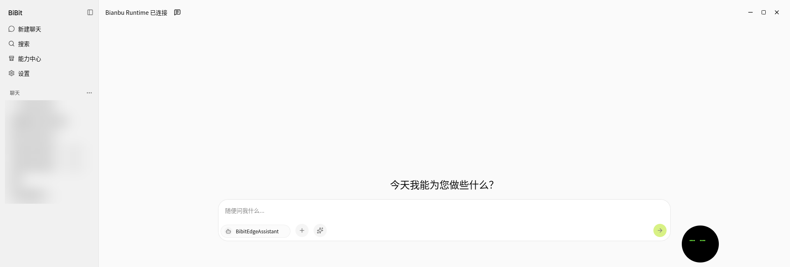
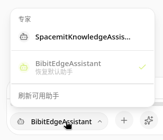

# 对话与会话管理

本页介绍主窗口入口、专家和临时技能，以及历史会话的整理方法。首次发送问题请参阅[快速开始](../quickstart.md)。

## 认识主窗口与桌面入口

图：主窗口与侧栏入口。

| 区域或入口 | 用途 |
| --- | --- |
| 左侧栏：新建聊天 | 开始一个新话题 |
| 左侧栏：搜索 | 按会话标题或对话内容查找聊天记录，具体使用方法见下文“搜索聊天记录” |
| 左侧栏：设置 | 调整语言、外观、桌面集成、快捷键和扩展 |
| 左侧栏：会话列表 | 返回历史会话，查看执行、待确认等状态 |
| 窗口中间：对话区 | 阅读问题、回答、工具执行结果和需要确认的操作 |
| 窗口底部：输入区 | 输入文字，选择专家、添加附件或临时技能；具体按钮取决于当前会话能力 |
| 系统托盘：BiBit 图标 | 打开快速对话；右键菜单可打开主窗口、显示或隐藏悬浮球、退出 BiBit |
| 桌面：BiBit 悬浮球 | 单击打开快速对话；双击打开主窗口，按住拖动可调整位置 |

左侧栏隐藏时，按 **Ctrl+B** 显示；再按一次隐藏。部分插件会在侧栏或设置中增加入口，例如 **能力中心**、**记忆**。没有这些入口的设备可以继续使用其他已就绪功能。相关操作参阅[能力中心](agent-hub.md)和[记忆](memory.md)。

## 对话、专家与技能

### 怎样提问更容易得到有用的回答

尽量写清楚“处理什么、想要什么结果、有什么限制”。例如：

> 请把下面这段通知改成适合发给同事的文字，保留会议时间和地点，控制在 150 字以内。

> 请根据我上传的文件列出三个重点，并说明每一点对应的内容。

需要修改回答时，直接补充要求，例如“再短一点”“换成表格”“保留第一项，重写后两项”。涉及重要事实时，打开原文件或参考资料自行核对。

### 选择专家

专家是面向特定任务的助手，例如设备实际提供的办公、文件处理或其他专门助手。

1. 点击 **新建聊天**。
2. 点击输入框下方显示的助手名称，打开 **专家** 列表。
3. 选择需要的专家，再输入问题并发送。
4. 如需回到默认助手，在列表中选择带有 **恢复默认助手** 说明的条目。

**预期结果：** 新会话由选定专家处理；进入会话后，可以查看会话显示的专家信息。

**注意：** 专家选择仅对新会话生效，不影响已有会话。已有会话继续使用创建时绑定的专家；如需使用其他专家，请新建聊天并选择相应专家。

专家列表为空时，可点击列表中的刷新入口。若提示未选择全局模型，请到 **设置 → 管理 → 模型列表** 添加并选择一个模型；其他不可用原因请先记录完整提示，无法自行解决时再到开发者社区提问。

图：点击输入框中的专家名称，查看当前可用专家。

### 为下一条消息临时选择技能

使用条件：当前助手服务支持技能选择，输入区显示星光形的 **调用技能** 按钮。

1. 点击该按钮。
2. 输入名称或描述搜索技能。
3. 点击需要的技能，确认输入区出现对应标签。
4. 输入这次任务的要求并发送。发送前不需要某项技能时，点击标签上的移除按钮。

**预期结果：** 选中的技能随下一条消息提交。下次需要时重新选择即可。

### 回答过程中继续输入或停止

- 回答过程中可以在输入框中准备下一条问题，建议等当前回答结束后再发送。当前 Runtime 会话不提供可编辑、取消或清空的消息排队列表。
- 需要中断当前回答时，点击输入框右下方的停止按钮，提示为 **停止生成**。

附件、截图或知识库任务可能要求等待上一轮完成。遇到明确的等待提示时，按提示处理，不要连续点击发送。

### 复制消息

当前 Runtime 会话仅支持复制消息。鼠标移到消息上，点击复制按钮即可将该条消息的文字复制到剪贴板。

| 操作 | 用途与结果 |
| --- | --- |
| 复制 | 将文字复制到剪贴板，之后可粘贴到其他应用 |

Runtime 当前不支持编辑、重新生成、继续生成、删除或切换消息版本，因此这些操作不会显示在 Runtime 会话中。

## 查找和整理历史会话

### 搜索聊天记录

1. 点击左侧栏的 **搜索**，或按 **Ctrl+K**。
2. 输入会话标题中的文字，或你发送的消息、助手回复中出现过的关键词。
3. 在搜索结果中选择需要的会话或消息。

**预期结果：**

- **会话**：显示标题与关键词匹配的会话，点击后打开该会话。
- **对话内容**：显示消息内容与关键词匹配的结果，包含所在会话和消息片段，点击后定位到对应消息。

搜索框为空时，可以从最近访问的记录中选择。

这里搜索的是聊天记录。查找电脑上的文件，请使用[本地文件查找](files.md#查找打开和总结本地文件)。

### 重命名、置顶与删除会话

把鼠标移到左侧会话标题上，点击旁边的 **…**，选择：

- **重命名**：输入容易辨认的标题，例如“周报整理”或“报销材料”。
- **置顶**：将常用会话排到列表前面；需要恢复时选择 **取消置顶**。
- **删除**：阅读确认提示后删除该会话。此操作不能作为暂停任务或普通清理缓存的方法。

会话列表中有多个会话时，分组标题旁的 **…** 菜单只提供 **全部删除**。选择后会出现确认提示；删除操作不可撤销。

### 看懂会话状态

| 状态或现象 | 下一步 |
| --- | --- |
| 运行中、转动图标 | 等待任务处理，也可以进入会话查看进度 |
| 等待确认、待审批标记 | 打开该会话，查看需要你决定的操作 |
| 完成但未读的提示 | 打开会话阅读结果 |
| 失败 | 查看具体错误，按提供的重试入口处理 |

[快速开始](../quickstart.md) · [常见问题](../faq.md) · [文档首页](../index.md)
