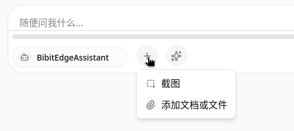
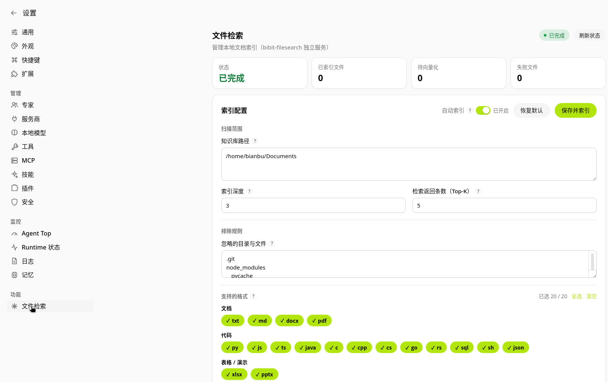

# 文件与资料

本页介绍添加附件、截图提问、检索本地文件，以及阅读知识库参考资料。相关能力需由当前设备和助手提供。

## 添加文档、文件与截图

### 添加文件并提问

使用条件：当前会话支持附件，输入区显示 **＋** 按钮。

1. 确认当前会话和专家正确。
2. 点击输入区 **＋ → 添加文档或文件**。
3. 在文件选择窗口中选择文件。
4. 确认输入区已显示文件标签。新会话的附件会保留为草稿，发送第一条消息时才上传；在已有会话中，如果 BiBit 提示附件仍在处理，请先等待。
5. 输入要求，例如“请总结这份文件，列出三项待办”，然后发送。

**预期结果：** 消息带有文件信息，助手根据服务和模型支持的能力处理文件并回答。只发送附件而没有文字时，系统可能使用默认的文件处理提示；希望结果明确时，建议写出具体要求。

文件是否支持、大小是否超过上限，以选择窗口和实际提示为准。能选中文件不代表当前模型一定能理解其内容。处理图片、扫描件、音视频等文件前，先确认设备提供相应能力。

图：输入框中的 **+** 菜单提供 **截图** 和 **添加文档或文件**。

### 上传失败或选错文件

- **上传失败**：点击失败附件的重试入口；按提示重新选择文件，或移除后重选。
- **正在处理**：等处理结束再发送，不要把仍在转动的文件标签当成已上传成功。
- **选错文件**：发送前移除附件。已有会话中移除标签不等于撤回已经发生的上传；敏感文件应在选择前确认。
- **切换会话**：发送前重新检查附件属于哪个会话，避免把材料发给错误的专家或任务。

### 截图问 BiBit

使用条件：当前 Bianbu 桌面提供可用的选区截图工具，且 BiBit 已启用截图入口。

1. 先进入需要接收截图的会话。
2. 点击 **＋ → 截图**，或使用已配置的截图快捷键，默认 **Super+Shift+S**。
3. 按屏幕提示选择截图区域。
4. 回到 BiBit 检查截图预览。需要补充时点击 **再截一张**；不需要的截图可移除或替换。一批最多保留 **5 张**截图。
5. 首次使用时阅读截图隐私说明。检查预览中是否含有密码、聊天内容或其他不准备提交的信息。
6. 在输入区写明问题，例如“请解释截图中的报错”，点击发送，并在出现 **要上传这些截图吗？** 时选择 **确认上传**。

**预期结果：** 确认后的截图作为当前会话的普通附件上传，之后由助手处理。

**注意：** 截图预览不是已经发送。出现“发送结果尚未确认”时，使用 **原样重试**，先处理原来的发送结果，不要反复创建新截图或更换原批次的接收专家。截图涉及上传，不能因为图片来自本机就认为处理过程一定完全离线。

## 查找、打开和总结本地文件

使用条件：当前专家已接入本地文件检索能力，并且允许搜索目标目录。

进入 **设置 → 功能 → 文件检索**，选择知识库路径后点 **保存并索引**。首次打开时路径默认为 `~/Documents`，可直接保存；索引完成后即可[用一句话查找文件](#用一句话查找文件)。路径、索引深度、支持格式等项可在同一页面调整。

图：在 **设置 → 功能 → 文件检索** 查看索引状态、知识库路径与支持格式。

### 用一句话查找文件

在聊天中描述你记得的文件名、主题或内容，例如：

> 请查找与“差旅报销”有关的本地文件。

> 帮我找一下包含“年度计划”的文档。

**预期结果：** 检索成功后，对话中显示文件结果卡片，列出文件名及可用的文件信息。没有结果时，换一个更具体的关键词；确认文件实际位于设备可搜索的范围内。

### 操作文件结果

| 想做什么 | 操作 |
| --- | --- |
| 打开文件 | 点击结果中的文件名 |
| 找到文件所在文件夹 | 点击该项的 **… → 打开所在目录** |
| 总结某一份文件 | 点击该项的单选按钮，再点击 **总结选中项** |
| 查看更多结果 | 浮窗最多显示 3 项，使用“打开主窗口”查看全部 |

**注意：** 点击文件名是打开文件，选择单选按钮才是指定总结对象。总结需要原会话处于可用状态；当前回答未结束时，等结束后再操作。

文件检索卡片展示的是候选结果，“相对匹配度”不是正确概率，也不代表已经完整读取了文件。显示的候选数量不等于设备中全部相关文件的总数。摘要、片段缺失时，打开原文件核对；文件已移动、删除或修改时，重新查找后再操作。

## 阅读知识库参考资料

使用条件：设备为当前助手接入了知识库能力，并且该次回答实际展示了知识库参考资料。

1. 在问题中写清楚资料范围和问题，例如“请根据已接入的知识库，说明这项功能的使用步骤，并给出参考资料”。
2. 等待检索和回答。
3. 如果消息中出现 **进迭知识库 · N 条参考资料**，展开查看资料片段；提供 **查看来源** 时，可以打开来源核对。

**预期结果：** 可以看见本次提供给模型的参考资料。是否实际检索，应以该条消息的资料展示和服务结果为准，仅在问题里写“知识库”不保证一定触发检索。

没有找到资料时，可换关键词、缩小问题范围，或改为一般问答。知识库参考资料不一定有独立开关，该入口并非所有版本和会话都提供。

[快速开始](../quickstart.md) · [常见问题](../faq.md) · [文档首页](../index.md)
