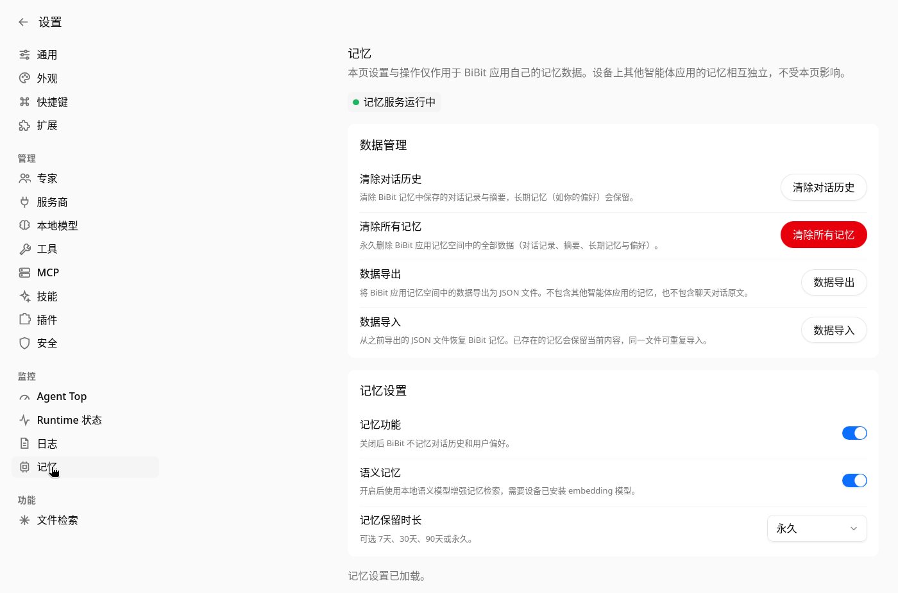

# 记忆

开启记忆后，BiBit 可以记住你的称呼、常用偏好，并参考之前交流的摘要，让后续回答更贴合你的习惯，减少重复说明。

你可以在聊天中明确告诉 BiBit：

- “请记住，以后叫我小明。”
- “请记住，我喜欢简洁的回答。”
- “请记住，推荐餐厅时优先考虑素食。”

开启记忆且保存成功后，BiBit 可以在后续聊天中参考这些信息。请勿将密码、验证码等敏感信息作为记忆保存。

记忆不等于完整聊天记录，BiBit 也不会保证记住每一句话。重要信息建议另行保存。

## 使用条件

进入 **设置 → 监控 → 记忆**，可查看以下页面。使用前，请确认页面提示记忆服务运行中。

## 管理记忆数据

| 操作 | 说明 |
| --- | --- |
| 清除对话历史 | 删除记忆中保存的对话记录和相关摘要，保留称呼、偏好等长期记忆。 |
| 清除所有记忆 | 删除 BiBit 已保存的全部记忆，包括称呼、偏好、对话记录和摘要。 |
| 数据导出 | 将已保存的记忆导出为 JSON 文件，方便备份。它不是完整聊天记录的备份。 |
| 数据导入 | 从之前导出的文件恢复记忆。已有记录保持不变，同一文件可重复导入，不会重复添加。 |

**清除记忆不会删除聊天窗口中的消息，也不会影响其他智能体应用的记忆。** 清除操作需要确认，且无法直接撤销，建议操作前先导出备份。

导出的文件可能包含个人偏好和对话内容，请妥善保管。

## 查看和调整设置

修改设置后，等待保存成功提示即可，无需重启 BiBit；如果保存失败，页面会恢复原有设置。

| 操作 | 说明 |
| --- | --- |
| 记忆功能 | 开启或关闭自动记忆。关闭后，BiBit 不再自动记录和使用记忆，已保存的数据不会被删除。 |
| 语义记忆 | 开启后，BiBit 更容易找到意思相关的记忆，需要设备具备对应的本地模型。此选项是否显示，以设备实际提供的功能为准。 |
| 记忆保留时长 | 可选 7 天、30 天、90 天或永久，用于设置对话记录和偏好等记忆的保存时间。 |

对话摘要用于帮助 BiBit 衔接近期交流，默认保存 7 天，不受上述保留时长设置影响。

[快速开始](../quickstart.md) · [常见问题](../faq.md) · [文档首页](../index.md)
