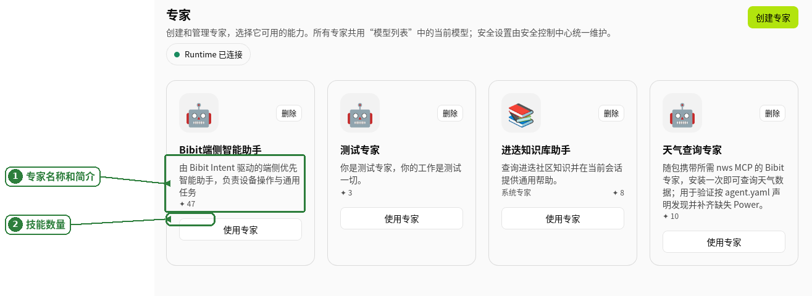
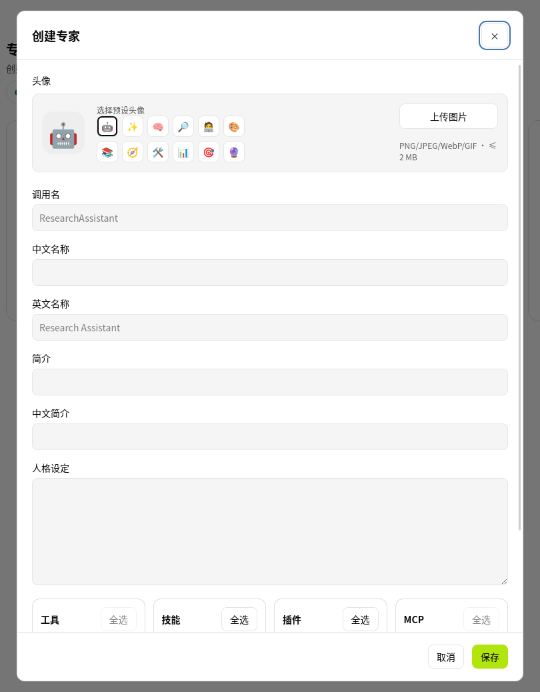

# 专家

**设置 → 管理 → 专家** 用于创建和管理 Agent 专家。每个专家有自己的名称、头像、介绍、Soul，以及可使用的工具、技能、插件和 MCP。这里的配置决定专家在聊天中能做什么。

在本页创建的专家使用[模型列表](runtime-providers.md)中的当前模型。已固定服务商和模型的专家仍使用其配置。BiBit 仍需先选中全局模型，才能发送新的 Runtime 对话消息。

使用条件：Runtime 已连接。页面顶部显示 **Runtime 不可用** 或 **宿主能力未提供** 时，先按[Runtime 管理与监控](runtime.md)中的说明检查扩展和服务状态。

图：绿色标注分别指出专家名称与简介，以及已启用的工具、技能、插件和 MCP 数量。

## 认识专家卡片

| 页面信息 | 含义 |
| --- | --- |
| **专家名称和简介** | 在聊天中选择专家时显示的说明 |
| **系统专家** | BiBit 或 Runtime 自带的专家，删除后需要重新安装或升级 Runtime 包才能恢复 |
| **尚未选择全局模型** | 该专家跟随全局模型，但当前未选中模型；先在[模型列表](runtime-providers.md)添加并选择 |
| **✦ 数字** | 该专家已启用的工具、技能、插件和 MCP 数量 |
| **使用专家** | 用该专家新建一个聊天会话 |
| **删除** | 删除专家及其本地配置，操作不可撤销 |

## 创建专家

1. 在 **专家** 页点击 **创建专家**。
2. 选择一个预设头像，或点击 **上传图片** 使用自己的头像。支持 PNG、JPEG、WebP、GIF，文件不超过 2 MB。
3. 填写名称信息：

   | 项目 | 建议 |
   | --- | --- |
   | **调用名** | 英文标识，例如 `ResearchAssistant` |
   | **中文名称**、**英文名称** | 聊天界面按语言显示的名称 |
   | **简介**、**中文简介** | 一句话说明这个专家擅长什么 |
   | **Soul** | 专家的角色、语气和工作要求；内容会影响回答风格 |

4. 在 **工具**、**技能**、**插件**、**MCP** 中勾选该专家可以使用的能力。标记为 **默认能力，所有专家固定启用** 或 **专家私有能力，不可取消** 的条目是灰色的，不能取消——前者由 Runtime 配置强制启用，后者属于这个专家自己的资源包。插件提供的技能和 MCP 只列在插件栏，勾选插件即启用其全部成员。
5. 点击 **保存**，等待保存成功提示。当前正在运行的任务不受影响。

**预期结果：** 专家出现在列表中，卡片显示能力数量，并且可以点击 **使用专家** 新建会话。

## 编辑和删除专家

- 点击专家卡片打开编辑窗口。修改后点击 **保存**。
- 专家提示 **尚未选择全局模型** 时，到[模型列表](runtime-providers.md)添加并选择一个模型后再使用。
- 点击卡片右上角的 **删除**，阅读确认提示后删除。删除不可撤销；系统专家删除后需要重新安装或升级 Runtime 包才能恢复。

## 使用专家开始聊天

点击 **使用专家**，BiBit 会创建并打开一个新的聊天会话。这个会话继续使用创建时绑定的专家；需要换一个专家处理其他任务时，重新从专家页或新建聊天页选择。

按钮不可用或被禁用时，常见原因是尚未选择全局模型、Runtime 未连接，或当前 BiBit 版本没有提供新建会话所需的宿主动作能力。先查看卡片上的说明和页面提示；若是模型问题，请到[模型列表](runtime-providers.md)处理，不需要修改专家配置。

## 安全策略不在专家页修改

专家页只负责名称、头像、简介、Soul 和能力选择。全局模型由[模型列表](runtime-providers.md)统一配置；工具是否允许调用、文件能访问哪些路径、网络是否放行等安全策略，统一在[安全](runtime-security.md)页面维护，不会因为编辑专家而自动放宽。

[Runtime 管理与监控](runtime.md) · [模型列表](runtime-providers.md) · [快速开始](../quickstart.md) · [常见问题](../faq.md) · [文档首页](../index.md)
