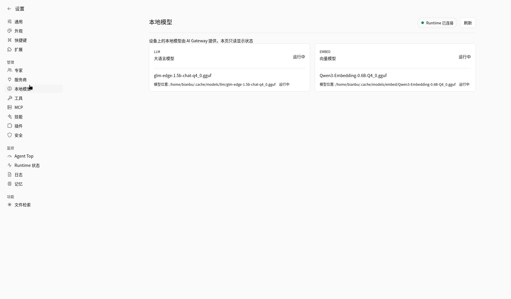

# 本地模型

**设置 → 管理 → 本地模型** 用于查看设备上的本地模型状态。页面只读显示 AI Gateway 提供的信息，不会在 BiBit 中下载、加载或卸载模型。

使用条件：Runtime 已连接，并且 AI Gateway 或 Bibit Intent 服务可访问。页面显示 **本地模型状态不可用** 时，按提示检查对应服务后点击 **重试**。

## 页面内容

页面分为 **大语言模型** 和 **向量模型** 两部分。每部分最多显示一个模型，并给出当前状态、模型位置和下载进度等可用信息。

| 状态 | 含义 |
| --- | --- |
| **运行中** | 模型服务正在运行 |
| **加载中** | 模型正在启动或加载，暂时不能使用 |
| **已加载** | 模型已加载，等待或可供服务调用 |
| **未加载** | 已登记模型，但当前没有运行 |
| **状态未知** | 服务没有返回可识别的状态 |
| **未在 AI Gateway 注册** | 设备上没有该类型模型的下载或加载记录 |

下载任务处于等待或下载中时，页面会显示进度百分比，并自动刷新状态。模型准备期间可以继续使用其他已就绪功能；读取本地模型状态失败不会直接中断聊天。

## 常见处理

- 页面提示 **本地模型响应无效**：记录完整提示并点击 **重试**；仍失败时，检查 Runtime 与 AI Gateway 的版本和连接。
- 页面提示服务不可用：先确认 AI Gateway 或 Bibit Intent 已启动，再点击 **重试**。
- 需要下载、启动、停止或切换模型：使用 AI Gateway 的管理方式。本地模型页只反映状态，不提供这些按钮。
- 模型显示 **未加载**：不代表模型文件损坏，可能只是当前没有启动。使用模型前，先确认对应服务已经加载。

## 注意

本地模型由设备上的 AI Gateway 统一管理，BiBit 不会因为打开这个页面而下载模型。页面上的模型名称、位置和进度来自 Runtime 转述，实际可用性以 AI Gateway 和对话结果为准。

[Runtime 管理与监控](runtime.md) · [专家](runtime-experts.md) · [快速开始](../quickstart.md) · [常见问题](../faq.md) · [文档首页](../index.md)
