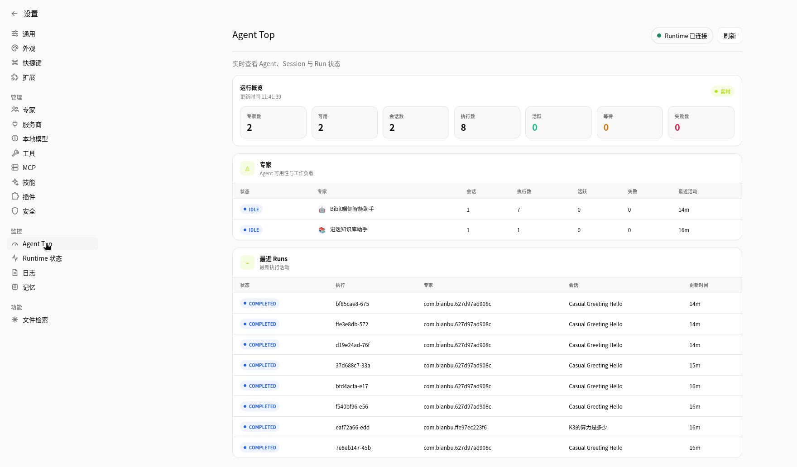

# Runtime 监控

**设置 → 监控** 中的三个页面用于查看 Runtime 的运行状态：**Agent Top**、**Runtime 状态** 和 **日志**。这些页面以只读查看为主，不会修改专家或安全策略。

使用条件：Runtime 已连接。页面每 3 秒自动刷新一次；也可以点击右上角的 **刷新** 立即读取。

## Agent Top

Agent Top 用于实时查看专家、会话和执行情况。

| 区域 | 内容 |
| --- | --- |
| **运行概览** | 专家数、可用专家、会话数、执行数、活跃执行、等待执行和失败数 |
| **专家** | 每个专家的状态、会话数、执行数、活跃执行、失败数和最近活动 |
| **最近 Runs** | 最近执行的状态、执行 ID、专家、会话和更新时间 |

点击页面顶部的 **刷新** 可以立即更新数据。状态和数字反映读取时的 Runtime 快照；短时间内没有变化时，先确认任务是否仍在执行或等待确认。

**最近活动** 为 `--`、`0s` 等相对时间，表示距读取时刻的间隔，不代表任务开始时间。

## Runtime 状态

Runtime 状态页显示 Control 进程和 Agent Worker 的运行关系。

| 区域 | 内容 |
| --- | --- |
| **运行概览** | Control PID、Worker 数、Runtime 状态和 Control 是否就绪 |
| **Control 进程** | PID、状态、模式、后端和是否启用沙箱 |
| **Worker 池** | 每个 Agent 对应的 Worker 状态、PID、模式、后端、沙箱、代次和错误 |

**Control** 是控制面进程，负责 API、会话和 Worker 调度。**Worker** 是实际执行 Agent 任务的进程。没有 Worker 时显示 **暂无 Worker**，通常表示还没有开始执行任务，或 Worker 尚未启动。

Worker 显示错误时，先记录完整错误并查看 **日志**；不要在没有确认原因时反复重启服务。

## 日志

日志页只读显示 `runtime.jsonl` 的运行日志，并按级别着色。

1. 使用 **DEBUG**、**INFO**、**WARNING**、**ERROR**、**CRITICAL** 复选框显示或隐藏对应级别。
2. 新日志出现时，页面自动滚动到末尾。
3. 没有记录时显示 **暂无日志记录。**

日志用于排查 Runtime 连接、Worker 启动、工具执行和服务错误。需要向开发者社区反馈时，只提供与问题相关的片段，并先移除个人信息、文件路径、API Key 和其他敏感内容。

## 看不到监控页面或数据为空

- 侧栏没有 **监控** 分组时，到 **设置 → 扩展** 检查 Runtime 管理扩展是否已安装并启用。
- 页面持续显示 **Runtime 不可用** 时，先检查 Runtime 服务是否运行；连接恢复后再刷新。
- 有页面但没有数据时，确认当前设备已经创建专家、会话或执行任务。刚启动的 Runtime 可能还没有产生记录。
- 日志为空不等于服务正常；结合 Runtime 状态和实际对话结果判断。

[Runtime 管理与监控](runtime.md) · [安全](runtime-security.md) · [快速开始](../quickstart.md) · [常见问题](../faq.md) · [文档首页](../index.md)
