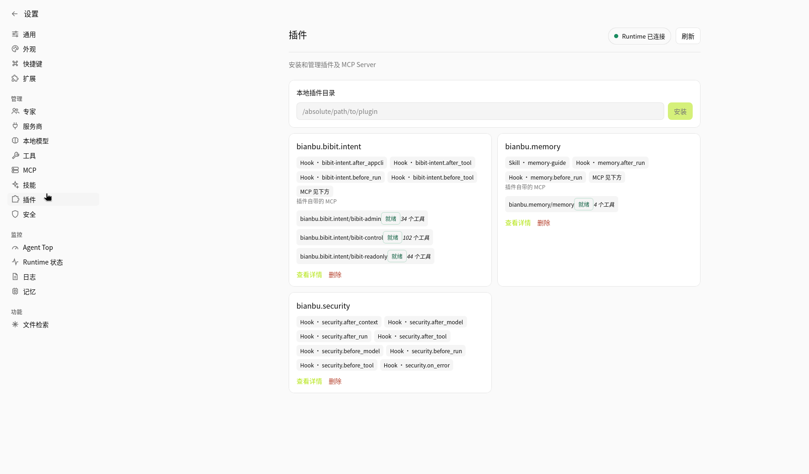

# 插件

**设置 → 管理 → 插件** 用于安装和管理 Runtime 后端插件，以及查看插件随包提供的 MCP。这里的“插件”和 BiBit 的 Feature 插件不是同一类对象。

使用条件：Runtime 已连接，并且插件目录位于设备本地。

## 先分清两种插件

| 入口 | 管理对象 | 典型用途 |
| --- | --- | --- |
| **设置 → 管理 → 插件** | Runtime 后端插件 | 为 Agent 增加工具、技能、Hook 或 MCP |
| **设置 → 扩展** | BiBit Feature 插件 | 安装能力中心、Runtime 控制台等 BiBit 界面扩展 |

要安装 BiBit 的 Feature 插件，请到 **设置 → 扩展**；本页不会安装或启停这些界面插件。

## 安装 Runtime 插件

1. 准备好插件在本机的绝对目录，例如 `/home/bianbu/plugins/my-plugin`。
2. 在 **本地插件目录** 中输入该路径。
3. 点击 **安装**，等待操作完成并刷新列表。
4. 查看插件卡片中的成员和 MCP 状态。插件提供的工具或技能会出现在对应目录中，能否使用还取决于专家配置。

**预期结果：** 插件出现在列表中，卡片显示插件 id、成员标签或自带的 MCP。需要查看完整元数据时，点击 **查看详情**。

## 插件成员与 MCP

插件卡片可能显示以下成员：

- **Hook**：插件挂载到 Runtime 生命周期的处理逻辑。
- **Skill**：插件提供的技能。
- **Tool**：插件提供的工具。
- **插件自带的 MCP**：插件启动的 MCP Server，会显示状态和工具数量；工具数无法读取时显示 **工具数未知**。

插件自带的 MCP 在插件页显示状态，不再重复出现在独立 MCP 列表里。需要查看独立安装的 MCP 时，到 [MCP](runtime-mcp.md) 页面。

## 删除插件

点击插件卡片上的 **删除**。删除会移除该插件及其成员，可能同时影响它提供的工具、技能和 MCP；依赖这些能力的专家配置可能需要调整。删除前先确认没有正在使用该插件的任务。

## 注意事项

- 只安装可信来源的插件目录。插件可以增加 Agent 能调用的能力，安装前应确认其用途和权限。
- 操作完成后如果页面没有更新，先刷新读取实际状态，不要连续重复提交。
- 插件显示在列表中不代表所有成员都可用；以卡片状态、工具目录和实际对话结果为准。
- 更新 Runtime 或安装新插件后，如果页面仍显示旧内容，先刷新；必要时完全退出并重新打开 BiBit。

[Runtime 管理与监控](runtime.md) · [MCP](runtime-mcp.md) · [工具](runtime-tools.md) · [技能](runtime-skills.md) · [快速开始](../quickstart.md) · [常见问题](../faq.md) · [文档首页](../index.md)
