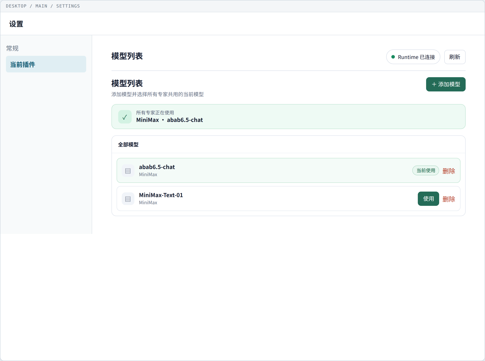
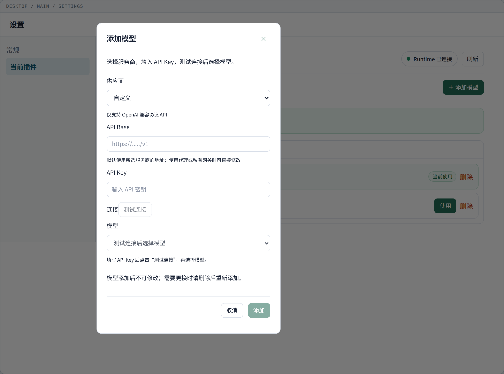

# 模型列表

在 **设置 → 管理 → 模型列表** 中，每个模型是独立条目，包含自己的服务商地址和凭据。列表中最多有一个**当前模型**，未固定模型的专家使用这一条目。

使用条件：Runtime 已连接。页面顶部显示 **Runtime 不可用** 时，先按[Runtime 管理与监控](runtime.md)检查扩展和服务状态。

## 认识模型列表

| 页面信息 | 含义 |
| --- | --- |
| **当前全局模型** | 显示未固定模型的专家所用的当前模型 |
| **全部模型** | 已添加的全部模型，带服务商与模型名 |
| **当前使用** | 该模型就是当前模型 |
| **使用** | 把这个模型切换为当前模型 |
| **删除** | 移除这个模型，需要时重新添加 |
| **还没有添加模型** | 尚未添加任何模型，先点 **添加模型** |

专家编辑器不提供单独的模型选择。已固定服务商和模型的专家仍使用其配置的组合。BiBit 仍需先选中全局模型，才能发送新的 Runtime 对话消息。

## 添加模型

1. 点击 **添加模型**。
2. 在 **供应商** 中选择服务商。有默认地址的预设会自动填写 **API Base**；选择 **自定义** 或 **Azure OpenAI** 时需自行填写。
3. 按需修改 **API Base**：使用代理或私有网关时，直接改成实际地址（通常以 `/v1` 结尾）。
4. 填写 **API Key**。
5. 点击 **测试连接**。成功后提示 **连接成功，找到 N 个模型，请选择一个**，随后在 **模型** 下拉里选择具体模型；失败时按提示检查地址与密钥。
6. 点击 **添加**。若当前没有选中的模型，新条目会成为当前模型；否则，想切换时再点击新条目的 **使用**。

**预期结果：** 模型出现在 **全部模型** 中，只有当前模型标记为 **当前使用**。

## 切换当前模型

在 **全部模型** 中点击目标模型的 **使用**。列表会立即标记新的 **当前使用**，不需要刷新页面。

正在运行的轮次不受影响；后续跟随全局模型的轮次使用新选择。

## 删除模型

点击模型行的 **删除** 并确认。删除当前模型会清空全局选择；再次发送 Runtime 对话消息前，请从列表选择另一个模型，若列表为空则先添加一个。

删除条目会移除已保存的配置。重新填写配置即可添加同一个模型。需要修改条目时，先删除再重新添加。

## 注意事项

- API Key 属于敏感信息，不要在聊天中发送，也不要截图分享完整密钥。
- **测试连接成功** 只表示服务商接受了这组凭据并返回了模型列表，不代表额度充足或后续一定可用；回答失败时结合错误提示排查。
- 本地模型服务（Ollama、LM Studio）填设备上实际监听的地址和端口；换端口后要同步修改 **API Base**。
- 设备上实际运行了哪些本地模型，见[本地模型](runtime-models.md)（该页只读显示状态）。

[Runtime 管理与监控](runtime.md) · [专家](runtime-experts.md) · [快速开始](../quickstart.md) · [常见问题](../faq.md) · [文档首页](../index.md)
