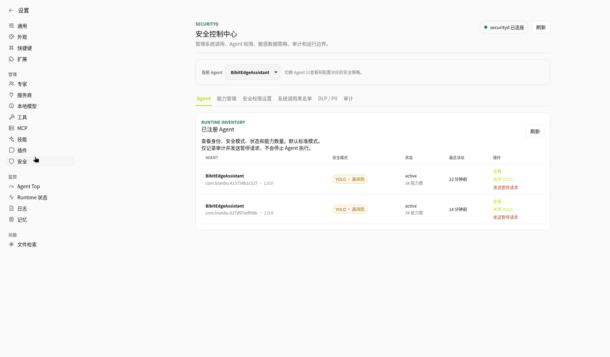

# 安全

**设置 → 管理 → 安全** 是 Runtime 的安全控制中心，用于管理 Agent 安全模式、工具授权、文件和网络边界、系统调用、DLP 策略与审计。这些设置会影响 Agent 能执行什么操作，修改前请确认自己理解影响范围。

使用条件：页面顶部显示 **securityd 已连接**。显示 **securityd 不可用** 或 **宿主能力未提供** 时，先按[Runtime 管理与监控](runtime.md)中的说明检查服务，不要直接修改策略。

## 选择当前 Agent

页面顶部有 **当前 Agent** 选择框。下面的能力管理、安全权限、系统调用、DLP 和审计都只作用于当前选中的 Agent。切换 Agent 后，页面会重新读取该 Agent 的策略。

页面包含六个页签：

| 页签 | 用途 |
| --- | --- |
| **Agent** | 查看已注册 Agent、安全模式、状态，并切换标准模式与 YOLO |
| **能力管理** | 为每个工具设置 `allow`、`ask` 或 `deny` |
| **安全权限设置** | 设置只读/读写路径和网络访问策略 |
| **系统调用黑名单** | 选择要拦截的系统调用 |
| **DLP / PII** | 设置敏感信息是脱敏还是放行 |
| **审计** | 查看安全事件并校验哈希链 |

## Agent 与安全模式

**Agent** 页签列出已注册 Agent。每一行显示安全模式、状态、最近活动和能力数量。

- **标准模式**：工具按 `allow` / `ask` / `deny` 执行；DLP、文件和网络边界、系统调用过滤生效。
- **YOLO · 高风险**：工具默认放行，跳过 DLP、文件与网络限制和审批，但保留审计。Agent 以更接近宿主的权限运行。
- **发送暂停请求**：只记录审计并向 Agent 发送暂停请求，不会停止 Agent 执行。需要真正停止任务时，使用对话中的停止入口。

切换安全模式会弹出确认窗口。阅读提示后再点击 **确认切换**。切回标准模式后，之前保存的限制会重新生效。

**YOLO 只适合你完全信任当前任务和 Agent 的场景。** 不确定影响时，保持标准模式。

## 能力管理

**能力管理** 决定“这个工具能不能调用”：

| 策略 | 行为 |
| --- | --- |
| `allow` | 直接放行 |
| `ask` | 调用前向你确认 |
| `deny` | 拒绝调用 |

1. 找到要调整的工具，在 **策略** 下拉框中选择 `allow`、`ask` 或 `deny`。修改会立即提交。
2. 点击 **新增工具策略** 可以手动填写工具名和策略。工具名可以从下拉建议中选择，也可以输入目录中尚未列出的名称。
3. 未在目录中声明的工具按 unmapped 默认策略处理。

页面顶部显示策略数量统计，例如 `3 allow · 1 ask · 0 deny`。策略变更以当前 Agent 为范围，不影响其他 Agent。

## 安全权限设置

**能力管理** 决定“能不能调用工具”，**安全权限设置** 决定“调用之后能碰什么”。

| 设置 | 说明 |
| --- | --- |
| **只读路径** | 每行一个路径，以 `--ro-bind` 挂载；能读不能写 |
| **读写路径** | 每行一个路径，以 `--bind` 挂载；读写都允许 |
| **网络访问模式** | **允许全部**、**白名单**、**全部拒绝**，部分环境还提供 **学习模式** |
| **白名单域名** | 网络模式为白名单时填写；每行一个域名，支持 `*.example.com` 通配符 |

路径必须以 `/` 开头，不能包含 `..`。读写权限已经包含读权限，同一路径不需要同时写在两个列表里。保存前页面会显示只读路径、读写路径和网络策略的变更数量；先核对 **保存前预览**，再点击 **保存并应用**。

页面上方的 **沙箱生效范围** 展示 Worker 启动时实际拿到的边界，包括声明路径、系统接线和默认基线。系统固定屏蔽的路径不能通过这里修改。

**保存后，新启动或重启的 Worker 才会应用新的文件与网络权限；已运行的 Worker 不会立即改变。** 出现部分保存失败时，按提示重试剩余变更。

## 系统调用黑名单

系统调用页按架构加载目录，默认跟随本机内核，也可以在 **架构** 中选择 `riscv64` 或 `x86_64`。

1. 勾选要拦截的系统调用，例如 `ptrace`。默认不限制，勾选即拦截，没有强制基线。
2. 点击 **保存策略**，确认页面显示待重启或已应用状态。
3. 发起一次新请求，Runtime 会自动重启 Worker。
4. 回到本页刷新，确认状态变为 **已应用**，并在 **系统调用拦截审计** 中看到记录。

系统调用策略仅在标准模式（沙箱）下装载。YOLO 下 Worker 以主机模式运行，不装载 seccomp；切回标准模式后，已保存的策略会恢复生效。**恢复默认** 会清除当前架构下为该 Agent 添加的拦截项。

## DLP / PII

DLP 页管理敏感信息的处理方式。每种 PII 类型只有两种动作：

- **脱敏**：将匹配到的内容替换或遮蔽。
- **放行**：不处理该类型。

可以逐项修改，也可以使用 **全部脱敏** 或 **全部放行**。批量操作只更新与目标动作不同的类型；出现部分失败时，未保存的数量会显示在提示中。**恢复默认** 会移除该类型的自定义策略。

页面下方提供 **DLP 文本试扫**。输入一段文本并点击 **扫描文本**，可以查看命中的项目数和脱敏后的结果。试扫不会发送聊天消息。

**YOLO 下不执行 DLP 扫描或检查**，但保留标准模式规则和审计记录。

## 审计

审计页记录安全 Hook、权限判定和策略变更，支持按 **全部事件**、**安全 Hook** 或 **仅拒绝** 过滤。

- 表格显示序号、时间、操作、目标和结果。
- 使用 **上一页** / **下一页** 翻页；翻页期间以同一快照读取记录。
- 点击 **校验哈希链** 检查审计记录是否完整。结果显示 **哈希链完整** 或 **校验失败**。
- 如果看到 **审计分页接口不可用，请更新 Runtime 和 Security 服务。**，先确认两个服务是否支持当前分页接口；更新后仍有问题时，记录完整提示并向开发者社区反馈。

审计记录可能包含工具名、路径和操作目标。分享日志或截图前，先检查是否包含个人信息、密钥或敏感路径。

## 修改安全策略前

1. 确认当前选中的 Agent 正确。
2. 阅读页面提示，分清标准模式与 YOLO 的差异。
3. 使用 **保存前预览** 核对路径、网络和策略变更。
4. 一次只修改一类设置，保存并验证结果后再继续。
5. 操作结果不明确时，先刷新或查看审计，不要连续重复提交。

[Runtime 管理与监控](runtime.md) · [专家](runtime-experts.md) · [快速开始](../quickstart.md) · [常见问题](../faq.md) · [文档首页](../index.md)
