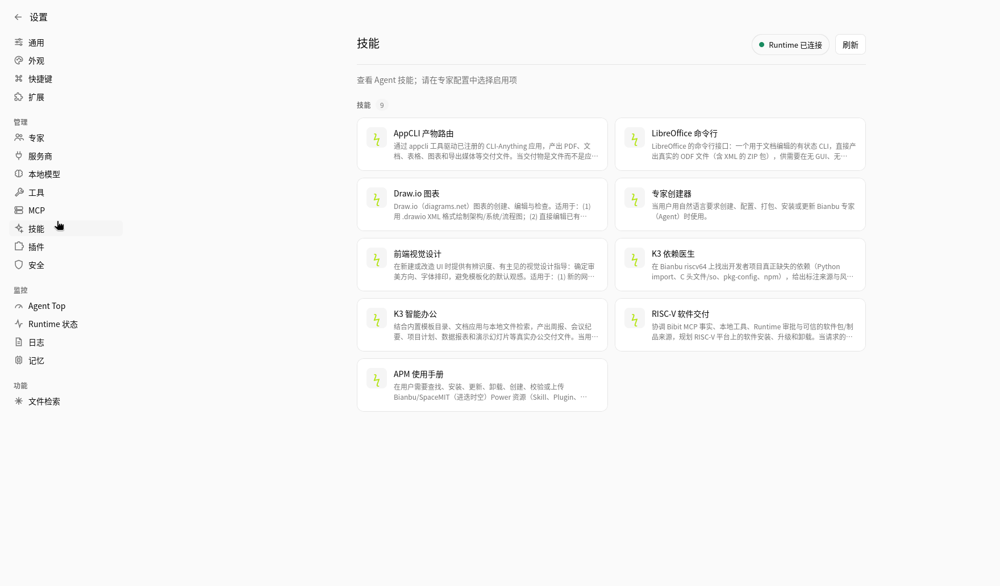

# 技能

**设置 → 管理 → 技能** 用于查看 Runtime 中可供 Agent 使用的技能。页面只读显示技能名称、说明和数量，实际启用哪个技能由专家配置决定。

使用条件：Runtime 已连接。

## 查看技能

技能卡片显示技能名称和用途说明。部分技能会带有语言相关的简介；找不到说明时，以技能名称和专家中的实际选择为准。

技能可能来自 Runtime 内置能力、插件或已安装的能力包。专家只使用被勾选的技能，以及 Runtime 固定的默认能力。

## 为专家启用技能

1. 打开[专家](runtime-experts.md)，选择需要技能的专家。
2. 在 **技能** 区域勾选需要的技能。标记为 **默认能力，所有专家固定启用** 的条目不能取消。
3. 点击 **保存**，等待保存成功提示。
4. 在后续聊天中直接描述任务。专家会根据配置选择技能，通常不需要手动说出技能名称。

**预期结果：** 保存后，专家可以使用所选技能；回答过程中实际使用了哪些技能，以对话中的技能引用或执行结果为准。

## 技能不显示或不能选择

- 确认页面顶部显示 **Runtime 已连接**；连接失败时，技能目录可能为空。
- 确认当前专家确实需要该技能；不同专家看到的可用技能可能不同。
- 技能由 Runtime、插件或能力包提供。本页不安装、更新或删除技能；需要安装或更新时，使用能力中心、插件或对应能力包的管理入口。
- 技能被标记为默认能力时不能取消，这是 Runtime 的统一配置，不是页面故障。

## 与临时技能的区别

聊天输入区的 **临时使用技能** 只对下一条消息生效；本页和专家配置决定的是专家长期可用的技能范围。需要一次性使用某个技能时，优先使用输入区的临时技能；需要长期改变专家能力时，再编辑专家配置。

[Runtime 管理与监控](runtime.md) · [专家](runtime-experts.md) · [工具](runtime-tools.md) · [快速开始](../quickstart.md) · [常见问题](../faq.md) · [文档首页](../index.md)
